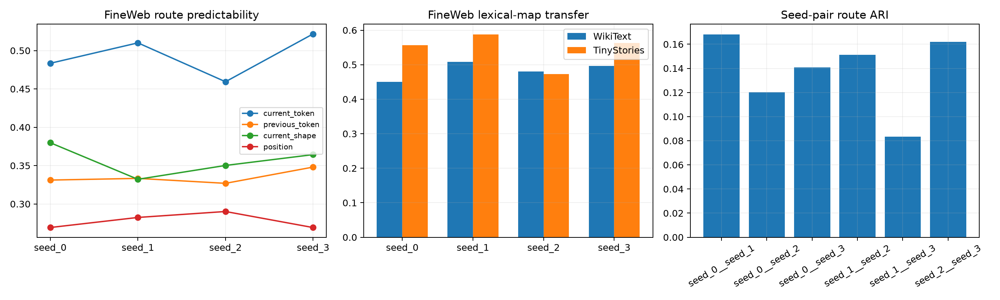

# Semantic atlas of the routed Layer-17 program

The atlas uses 32,000 disjoint FineWeb sites and 12,800 sites from each OOD corpus. Route labels are audited against token identity, structural token shape, position, adjacent tokens, seed-stable semantic profiles, weight-derived output roles, and decoded high-confidence contexts.

## Locked hypotheses

- **E1_current_token_predicts_routes: supported.**
- **E2_lexical_routes_transfer_ood: supported.**
- **E3_routes_are_not_position_lookup: supported.**
- **E4_structural_shape_has_signal: supported.**
- **E5_semantic_profiles_recur: supported.**
- **E6_route_partitions_recur_pairwise: not supported.**

| Seed | Fine current-token | Fine current-shape | Fine position | Wiki lexical transfer | Tiny lexical transfer |
|---|---:|---:|---:|---:|---:|
| seed_0 | 0.483 | 0.380 | 0.269 | 0.451 | 0.556 |
| seed_1 | 0.510 | 0.332 | 0.282 | 0.508 | 0.588 |
| seed_2 | 0.459 | 0.350 | 0.290 | 0.481 | 0.472 |
| seed_3 | 0.522 | 0.364 | 0.269 | 0.497 | 0.562 |

### Reference-seed worked examples

#### Expert 0

Share 0.225. Lifted current tokens: '<|endoftext|>', ' (', '\n', '!'. Approximate weight-based output role promotes 'skip', 'summary', 'updated', 'objects'; suppresses ' ACTIONS', ' boolean', ' INFO', ' parser'.

- `\ncool!,but... why would the pumpkin have blood?\nmaybe she stuffed a dead body in` (current `
`, confidence 1.000)
- ` country - and maybe the world. Wriston is the person who gave` (current ` W`, confidence 1.000)
- ` favorite multiplayer shooter games and cut graphics down to the bone?\nWhat would be left?\nBel` (current `
`, confidence 1.000)

#### Expert 1

Share 0.259. Lifted current tokens: 'os', 'i', ' him', ' them'. Approximate weight-based output role promotes ' down', ' present', ' at', ' set'; suppresses ' retaliate', ' hers', 'his', ' havoc'.

- `uri Sozen, Otomo Kage, Bayushi Yoshimi and Kakita Tiru. While` (current `imi`, confidence 1.000)
- ` Aadhaar number and finger authentication," says Nirmal Prakash, managing director at Smart Identity Devices` (current `ash`, confidence 1.000)
- `\nPhoto credit: NASA/Dimitri Gerondidakis\nWashington,` (current `itri`, confidence 1.000)

#### Expert 2

Share 0.246. Lifted current tokens: ' We', ' they', ' can', ' we'. Approximate weight-based output role promotes ' Integer', ' Depths', ' Absent', ' Godd'; suppresses ' s', ' 12', ' post', ' St'.

- ` systems. If possible, you need to ensure that you choose a rental apartment` (current ` to`, confidence 1.000)
- ` kind of 20-somethings tackle life together, they also bond in humorous and often w` (current ` they`, confidence 1.000)
- ` delighted when the film’s director ask them to re-enact these murders for their documentary` (current `-`, confidence 1.000)

#### Expert 3

Share 0.270. Lifted current tokens: ' his', ' your', ' the', ' our'. Approximate weight-based output role promotes ' gp', ' Recomm', ' namespace', ' parser'; suppresses ' decap', ' retaliate', 'gettable', 'tackle'.

- `ist and pan-European think and do tank"\nWhy a European movement at a city level?` (current ` a`, confidence 1.000)
- ` closer to the people. Europe is often seen very far from the people. One way to change that` (current ` the`, confidence 1.000)
- ` 47.2 mm (1.88 inch) thick. The starting price of the DTR machine` (current ` The`, confidence 1.000)

Exact expert names remain seed-dependent. Recurrent coarse profiles support a semantic routing ontology; failure of profile or ARI gates means examples should be treated as one quantization's implementation details.
