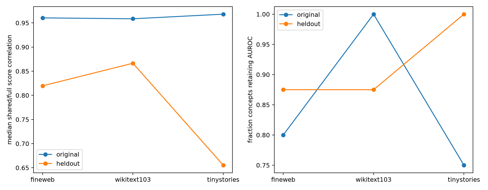

# Layer-17 shared-score fidelity red-team

This separates semantic prediction from reconstruction. Oriented AUROC treats coherent suppression and promotion symmetrically; score correlation and centered R-squared ask whether the frozen 32D quadratic quotient numerically reproduces the full output-conditioned MLP contribution on language states.

## Locked hypotheses

- **Y1_original_score_correlation: supported.**
- **Y2_heldout_score_correlation: supported.**
- **Y3_original_executable_fidelity: supported.**
- **Y4_per_concept_semantic_retention: supported.**
- **Y5_cross_term_fidelity_gain: supported.**

| Corpus | Group | Full oriented AUROC | Shared AUROC | Score correlation | Centered R² | Semantic retention |
|---|---|---:|---:|---:|---:|---:|
| fineweb | original | 0.696 | 0.684 | 0.960 | 0.922 | 80.0% |
| fineweb | heldout | 0.621 | 0.683 | 0.820 | 0.650 | 87.5% |
| wikitext103 | original | 0.725 | 0.721 | 0.959 | 0.913 | 100.0% |
| wikitext103 | heldout | 0.657 | 0.697 | 0.866 | 0.700 | 87.5% |
| tinystories | original | 0.713 | 0.705 | 0.968 | 0.913 | 75.0% |
| tinystories | heldout | 0.675 | 0.736 | 0.655 | 0.429 | 100.0% |

Per-concept fidelity and semantic results are in `layer17_score_fidelity.json`.
