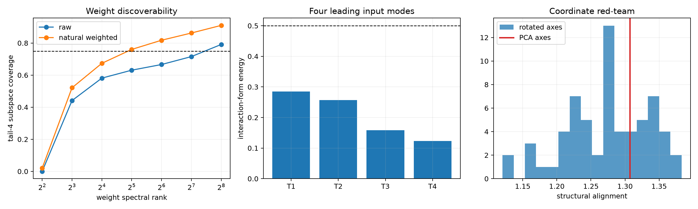

# Layer-17 residual-tail circuit red-team

The four axes are the leading FineWeb residual-write PCs after projecting away the strict full-width weight outliers. They are frozen before this test. We ask whether raw or natural-covariance-weighted tensor spectra discover them, whether each axis has a compact exact input form, and whether those forms survive finite interventions on disjoint FineWeb and OOD panels.

## Locked hypotheses

- **R1_raw_top64_recovers_tail: not supported.**
- **R2_natural_weighting_improves_early_recovery: not supported.**
- **R3_tail_axes_have_compact_input_forms: not supported.**
- **R4_weight_formula_predicts_tail_edits: supported.**
- **R5_tail_top_modes_are_scalar_specific: supported.**
- **R6_tail_top_modes_reach_behavior: supported.**
- **R7_pca_axes_are_semantically_privileged: not supported.**
- **R8_tail_axes_have_simple_output_roles: supported.**

| Weight rank | Raw tail-4 coverage | Natural-weighted tail-4 coverage |
|---:|---:|---:|
| 4 | 0.000 | 0.020 |
| 8 | 0.441 | 0.521 |
| 16 | 0.581 | 0.674 |
| 32 | 0.631 | 0.760 |
| 64 | 0.666 | 0.818 |
| 128 | 0.716 | 0.862 |
| 256 | 0.791 | 0.910 |

| Tail axis | Best raw weight rank / cosine | Output role / AUROC | Input top-4 energy |
|---:|---:|---|---:|
| 1 | 6 / 0.627 | closing_delimiter / 0.764 | 0.285 |
| 2 | 5 / 0.677 | comma_period / 0.852 | 0.257 |
| 3 | 6 / 0.389 | comma_period / 0.907 | 0.159 |
| 4 | 7 / 0.436 | quote / 0.803 | 0.124 |

| Corpus | Median top/low scalar ratio | Components with ≥4× top/low KL | Median exact prediction corr. |
|---|---:|---:|---:|
| fineweb | 46109.7× | 4/4 | 1.000 |
| wikitext | 37174.3× | 4/4 | 1.000 |
| tinystories | 100732.9× | 4/4 | 1.000 |

PCA-axis structural alignment: **1.307**; random-rotation median **1.275**; empirical `p=0.3077`.

The rotation null preserves the entire tail-4 subspace and changes only its coordinate axes. Passing it would justify interpreting individual PCA coordinates; failing it would leave the subspace interpretable while making the four-axis naming noncanonical. Natural weighting uses the FineWeb input covariance and is therefore a distribution-conditioned cleaning, not a distribution-free RMT spectrum.
