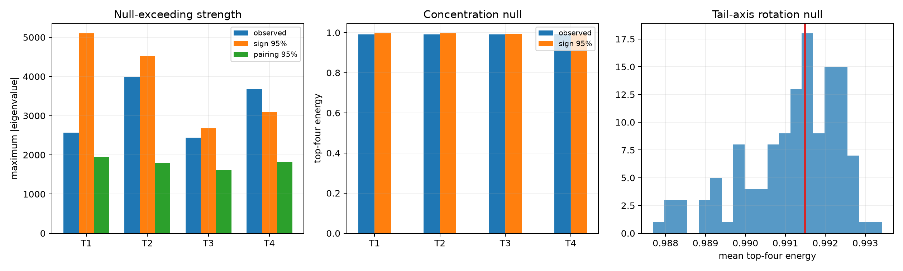

# High-resolution null red-team for cleaned Layer-17 tail forms

The previous 32-draw sign threshold was too coarse for a borderline result. This rerun uses 128 sign nulls and 128 coefficient-to-input-form pairing nulls per frozen tail axis. A separate rotation null preserves the complete tail-4 output subspace and changes only its coordinate basis.

## Locked hypotheses

- **N1_every_axis_beats_sign_null: not supported.**
- **N2_every_axis_beats_pairing_null: supported.**
- **N3_concentration_exceeds_sign_null: not supported.**
- **N4_pca_coordinates_are_spectrally_privileged: not supported.**
- **N5_at_least_one_robust_cleaned_spike: supported.**

| Axis | Observed max | Sign median / p | Pairing median / p | Observed top-4 | Sign top-4 95% / p |
|---:|---:|---:|---:|---:|---:|
| 1 | 2566.3 | 2352.7 / 0.4496 | 847.1 / 0.0233 | 0.990 | 0.996 / 0.3876 |
| 2 | 3991.4 | 2170.3 / 0.1318 | 743.5 / 0.0078 | 0.991 | 0.996 / 0.2636 |
| 3 | 2437.8 | 1259.4 / 0.1008 | 691.3 / 0.0078 | 0.991 | 0.993 / 0.1163 |
| 4 | 3671.9 | 1302.9 / 0.0310 | 744.6 / 0.0078 | 0.994 | 0.994 / 0.0853 |

PCA-coordinate mean top-four energy **0.991**; rotation-null median **0.991**; empirical `p=0.4574`.

Sign and pairing nulls answer whether learned channel coordination makes a fixed output form exceptional. The rotation null answers whether PCA chose special axes inside the already selected tail subspace. None corrects for all possible researcher choices, so a null-exceeding result remains a circuit candidate until tied to held-out finite behavior.
