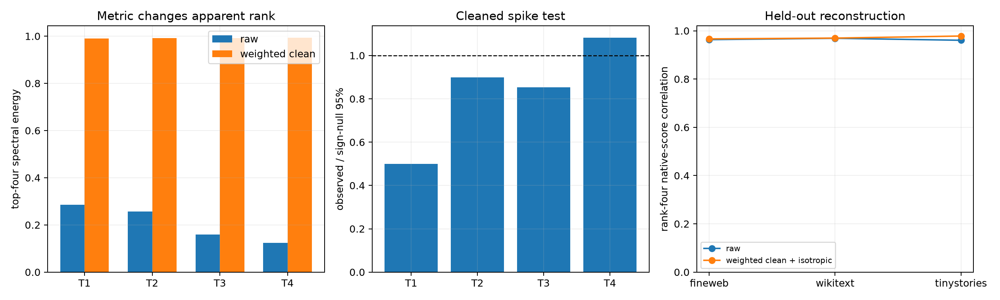

# Layer-17 residual-tail input-metric cleaning sweep

Each frozen residual-tail output axis defines an exact 1,152×1,152 bilinear input form. `raw` uses the Euclidean parameter metric. `covariance weighted` rewrites the same scalar operation in FineWeb second-moment coordinates (`x = S z`). `trace cleaned` separates the isotropic quadratic term before ranking modes. The isotropic term is then restored when native-score fidelity is assessed, so cleaning is not allowed to silently change the function.

## Locked hypotheses

- **C1_covariance_metric_concentrates_tail_forms: supported.**
- **C2_trace_cleaned_tail_axes_exceed_sign_nulls: not supported.**
- **C3_clean_top4_reconstructs_clean_scores: supported.**
- **C4_cleaning_improves_native_score_reconstruction: not supported.**
- **C5_isotropic_remainder_is_not_the_explanation: supported.**
- **C6_clean_rank4_transfers_ood: supported.**

| Tail axis | Raw top-4 energy | Weighted clean top-4 | Weighted eff. rank | Sign-null outlier ratio |
|---:|---:|---:|---:|---:|
| 1 | 0.285 | 0.990 | 2.6 | 0.50× |
| 2 | 0.257 | 0.991 | 1.3 | 0.90× |
| 3 | 0.159 | 0.991 | 2.0 | 0.85× |
| 4 | 0.124 | 0.994 | 1.1 | 1.08× |

| Corpus | Raw rank-4 native corr. | Weighted rank-4 native corr. | Weighted clean corr. | Without isotropic remainder |
|---|---:|---:|---:|---:|
| fineweb | 0.963 | 0.966 | 0.972 | 0.989 |
| wikitext | 0.969 | 0.970 | 0.975 | 0.993 |
| tinystories | 0.961 | 0.978 | 0.981 | 0.991 |

Covariance weighting is an activation-conditioned choice of metric. It can reveal operations that are compact on natural states but diffuse in raw Frobenius norm; it cannot establish a distribution-free tensor circuit. Channel-sign nulls preserve coefficient magnitudes but do not correct for the fact that the four tail axes were selected from FineWeb write covariance.
