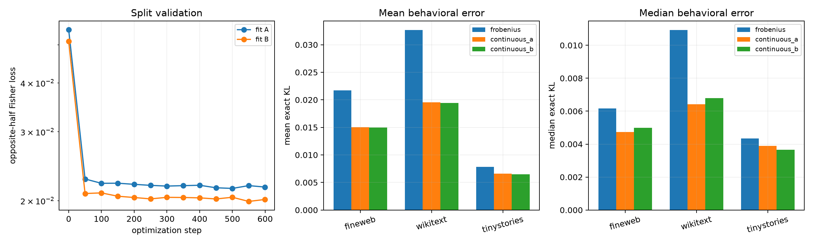

# Continuous downstream-Fisher optimization of the Layer-17 tail program

The tail tensor, FineWeb covariance metric, 128D tensor-derived candidate pool, and rank-eight budget are frozen. Two independent fits optimize an orthonormal 8D subspace on alternating discovery rows using pulled-back final-logit Fisher error; each is validated on the other half and on disjoint FineWeb/WikiText/TinyStories with exact finite KL.

## Locked hypotheses

- **O1_continuous_fit_improves_heldout_fisher: supported.**
- **O2_continuous_fit_improves_external_mean_kl: supported.**
- **O3_continuous_fit_improves_external_median_kl: supported.**
- **O4_independent_fits_recover_same_subspace: supported.**
- **O5_improvement_replicates_across_fits: supported.**
- **O6_continuous_rank8_reaches_behavioral_gate: not supported.**

Independent optimized-subspace canonical cosine: mean **0.974**, minimum **0.921**.

| Corpus | Program | Score R² | Mean exact KL | Median exact KL |
|---|---|---:|---:|---:|
| fineweb | frobenius | 0.949 | 0.02172 | 0.00617 |
| fineweb | continuous_a | 0.677 | 0.01504 | 0.00473 |
| fineweb | continuous_b | 0.694 | 0.01497 | 0.00500 |
| wikitext | frobenius | 0.969 | 0.03265 | 0.01092 |
| wikitext | continuous_a | 0.926 | 0.01956 | 0.00642 |
| wikitext | continuous_b | 0.918 | 0.01945 | 0.00680 |
| tinystories | frobenius | 0.983 | 0.00781 | 0.00435 |
| tinystories | continuous_a | 0.942 | 0.00660 | 0.00389 |
| tinystories | continuous_b | 0.936 | 0.00648 | 0.00365 |

| Program | Even-row Fisher | Odd-row Fisher | Discovery score R² |
|---|---:|---:|---:|
| continuous_a | 1.8144e-02 | 2.1671e-02 | 0.732 |
| continuous_b | 2.0140e-02 | 1.9681e-02 | 0.749 |
| frobenius | 3.0824e-02 | 3.2682e-02 | 0.966 |

A stable improvement would show that the tail is globally compact but ordered by the wrong metric. Split instability or OOD reversal would instead identify a context/distribution-dependent behavioral quotient. The optimization remains restricted to the frozen tensor-derived 128D pool and does not alter the model.
