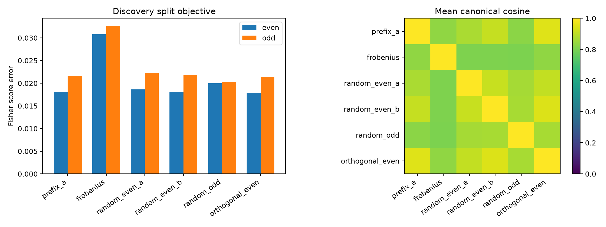

# Random-start red team of the continuous Layer-17 Fisher subspace

The earlier two split fits shared a near-Frobenius initialization. This preregistered red team repeats the frozen rank-eight problem from three random starts and one start deliberately orthogonal to the Frobenius prefix.

## Locked hypotheses

- **B1_random_starts_improve_heldout_fisher: supported.**
- **B2_random_fits_recover_same_subspace: supported.**
- **B3_random_fits_match_prefix_solution: supported.**
- **B4_random_improvement_transfers: not supported.**
- **B5_adversarial_start_escapes: supported.**
- **B6_random_solution_reaches_gate: not supported.**

| Program | Even Fisher | Odd Fisher | Cosine to prefix |
|---|---:|---:|---:|
| prefix_a | 1.8144e-02 | 2.1671e-02 | 1.000 |
| frobenius | 3.0824e-02 | 3.2682e-02 | 0.836 |
| random_even_a | 1.8617e-02 | 2.2304e-02 | 0.871 |
| random_even_b | 1.8061e-02 | 2.1814e-02 | 0.913 |
| random_odd | 2.0019e-02 | 2.0278e-02 | 0.827 |
| orthogonal_even | 1.7817e-02 | 2.1335e-02 | 0.950 |

| Corpus | Program | Mean exact KL | Median exact KL | Top-1 agreement |
|---|---|---:|---:|---:|
| fineweb | prefix_a | 0.01504 | 0.00473 | 0.941 |
| fineweb | frobenius | 0.02172 | 0.00617 | 0.930 |
| fineweb | random_even_a | 0.01486 | 0.00419 | 0.944 |
| fineweb | random_even_b | 0.01452 | 0.00419 | 0.945 |
| fineweb | random_odd | 0.01480 | 0.00425 | 0.943 |
| fineweb | orthogonal_even | 0.01452 | 0.00431 | 0.946 |
| wikitext | prefix_a | 0.01956 | 0.00642 | 0.927 |
| wikitext | frobenius | 0.03265 | 0.01092 | 0.901 |
| wikitext | random_even_a | 0.02062 | 0.00571 | 0.927 |
| wikitext | random_even_b | 0.01986 | 0.00573 | 0.927 |
| wikitext | random_odd | 0.02034 | 0.00557 | 0.928 |
| wikitext | orthogonal_even | 0.02031 | 0.00606 | 0.925 |
| tinystories | prefix_a | 0.00660 | 0.00389 | 0.948 |
| tinystories | frobenius | 0.00781 | 0.00435 | 0.946 |
| tinystories | random_even_a | 0.00782 | 0.00353 | 0.951 |
| tinystories | random_even_b | 0.00769 | 0.00365 | 0.949 |
| tinystories | random_odd | 0.00729 | 0.00324 | 0.953 |
| tinystories | orthogonal_even | 0.00749 | 0.00357 | 0.949 |

Agreement after random and adversarial initialization is evidence for a recoverable behavioral subspace. Failure would demote the earlier stable-looking basis to one useful local quotient rather than a canonical circuit.
