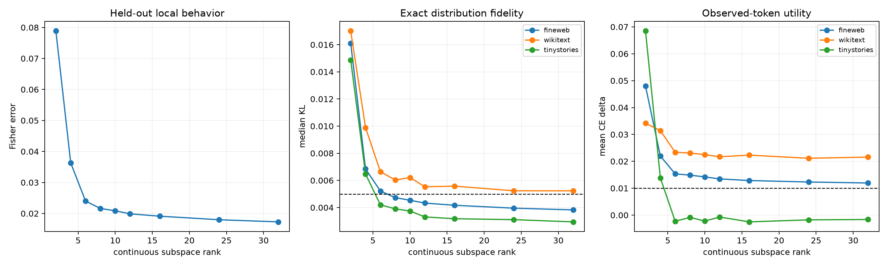

# Continuous Layer-17 behavioral rank frontier

A fixed 128D tensor-derived input pool is compressed to continuously optimized subspaces from rank 2 through 32. Fits use even FineWeb discovery rows, validate on odd rows, and are evaluated with exact final-logit interventions on disjoint FineWeb, WikiText, and TinyStories.

## Locked hypotheses

- **R1_fisher_error_decreases_with_rank: supported.**
- **R2_rank16_reaches_median_kl_gate: not supported.**
- **R3_rank16_improves_rank8_mean_kl: not supported.**
- **R4_rank16_preserves_task_ce: not supported.**
- **R5_rank32_is_high_fidelity: not supported.**
- **R6_smallest_universal_gate_is_at_most_16: not supported.**

Smallest tested universal median-KL gate: **None**.

| Rank | Opposite-half Fisher | fineweb median KL / mean KL / CE Δ / top1 | wikitext median KL / mean KL / CE Δ / top1 | tinystories median KL / mean KL / CE Δ / top1 |
|---:|---:|---:|---:|---:|
| 2 | 7.8854e-02 | 0.01611 / 0.04245 / 0.04795 / 0.890 | 0.01701 / 0.04460 / 0.03419 / 0.885 | 0.01486 / 0.04417 / 0.06846 / 0.896 |
| 4 | 3.6330e-02 | 0.00685 / 0.02243 / 0.02198 / 0.925 | 0.00989 / 0.02831 / 0.03141 / 0.905 | 0.00647 / 0.01352 / 0.01382 / 0.932 |
| 6 | 2.3997e-02 | 0.00522 / 0.01622 / 0.01535 / 0.937 | 0.00665 / 0.01992 / 0.02338 / 0.925 | 0.00420 / 0.00715 / -0.00228 / 0.947 |
| 8 | 2.1622e-02 | 0.00473 / 0.01491 / 0.01487 / 0.938 | 0.00603 / 0.01907 / 0.02309 / 0.928 | 0.00390 / 0.00670 / -0.00085 / 0.948 |
| 10 | 2.0874e-02 | 0.00454 / 0.01444 / 0.01420 / 0.942 | 0.00621 / 0.01847 / 0.02251 / 0.929 | 0.00374 / 0.00646 / -0.00222 / 0.951 |
| 12 | 1.9887e-02 | 0.00433 / 0.01395 / 0.01347 / 0.943 | 0.00553 / 0.01739 / 0.02170 / 0.930 | 0.00331 / 0.00580 / -0.00071 / 0.955 |
| 16 | 1.9128e-02 | 0.00417 / 0.01339 / 0.01286 / 0.944 | 0.00558 / 0.01737 / 0.02231 / 0.930 | 0.00318 / 0.00556 / -0.00251 / 0.956 |
| 24 | 1.7983e-02 | 0.00395 / 0.01288 / 0.01231 / 0.945 | 0.00524 / 0.01638 / 0.02114 / 0.933 | 0.00311 / 0.00535 / -0.00177 / 0.955 |
| 32 | 1.7292e-02 | 0.00383 / 0.01229 / 0.01195 / 0.947 | 0.00523 / 0.01664 / 0.02158 / 0.932 | 0.00294 / 0.00539 / -0.00164 / 0.955 |

KL measures imitation of the native model; CE delta measures task loss against the observed next token. They answer different questions and are reported together.
