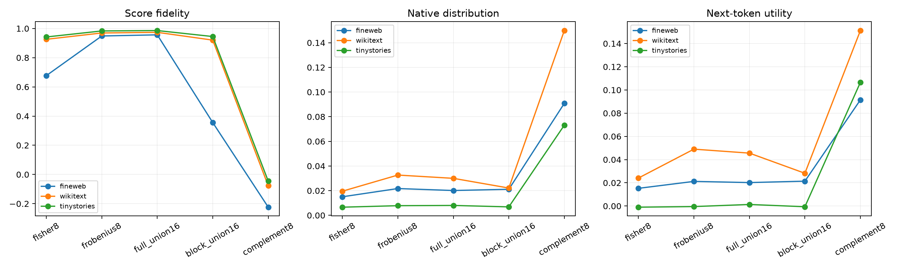

# Cross-term red team of the Layer-17 dual-metric union

The same 16D span is evaluated either as one full bilinear block or as two additive 8D blocks. Only cross-terms differ.

## Locked hypotheses

- **X1_block_union_beats_full_union: not supported.**
- **X2_block_union_improves_fisher8: not supported.**
- **X3_block_union_reaches_median_gate: not supported.**
- **X4_cross_terms_are_behaviorally_material: supported.**
- **X5_block_union_preserves_task_ce: not supported.**

| Corpus | Program | Score R² | Mean KL | Median KL | CE Δ | Top1 |
|---|---|---:|---:|---:|---:|---:|
| fineweb | fisher8 | 0.677 | 0.01504 | 0.00473 | 0.01525 | 0.941 |
| fineweb | frobenius8 | 0.949 | 0.02172 | 0.00617 | 0.02122 | 0.930 |
| fineweb | full_union16 | 0.957 | 0.02012 | 0.00603 | 0.02021 | 0.932 |
| fineweb | block_union16 | 0.356 | 0.02112 | 0.00502 | 0.02142 | 0.937 |
| fineweb | complement8 | -0.224 | 0.09082 | 0.03047 | 0.09146 | 0.847 |
| fineweb | full→block cross-term divergence | — | 0.00840 | 0.00152 | — | — |
| wikitext | fisher8 | 0.926 | 0.01956 | 0.00642 | 0.02411 | 0.927 |
| wikitext | frobenius8 | 0.969 | 0.03265 | 0.01092 | 0.04901 | 0.901 |
| wikitext | full_union16 | 0.974 | 0.03000 | 0.01062 | 0.04559 | 0.904 |
| wikitext | block_union16 | 0.920 | 0.02213 | 0.00691 | 0.02823 | 0.924 |
| wikitext | complement8 | -0.077 | 0.14988 | 0.04518 | 0.15120 | 0.813 |
| wikitext | full→block cross-term divergence | — | 0.00686 | 0.00246 | — | — |
| tinystories | fisher8 | 0.942 | 0.00660 | 0.00389 | -0.00099 | 0.948 |
| tinystories | frobenius8 | 0.983 | 0.00781 | 0.00435 | -0.00047 | 0.946 |
| tinystories | full_union16 | 0.986 | 0.00801 | 0.00467 | 0.00134 | 0.943 |
| tinystories | block_union16 | 0.945 | 0.00685 | 0.00375 | -0.00061 | 0.949 |
| tinystories | complement8 | -0.046 | 0.07312 | 0.03485 | 0.10659 | 0.854 |
| tinystories | full→block cross-term divergence | — | 0.00284 | 0.00137 | — | — |

A block advantage would mean the added directions are useful but their induced pairwise interactions are not. Failure means the extra variance directions themselves are behaviorally misaligned, beyond the cross-term issue.
