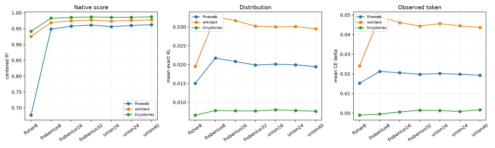

# Dual-metric union for the Layer-17 tail program

This test asks whether the high-variance Frobenius core and the downstream-sensitive Fisher core are complementary. Their span is evaluated without refitting by exact final-logit interventions on three corpora.

## Locked hypotheses

- **U1_union16_improves_fisher8_mean_kl: not supported.**
- **U2_union16_reaches_median_kl_gate: not supported.**
- **U3_union16_preserves_native_scores: supported.**
- **U4_union16_preserves_task_ce: not supported.**
- **U5_union16_reaches_top1_gate: not supported.**
- **U6_larger_union_has_diminishing_returns: supported.**

| Corpus | Program | Rank | Score R² | Mean KL | Median KL | CE Δ | Top1 |
|---|---|---:|---:|---:|---:|---:|---:|
| fineweb | fisher8 | 8 | 0.677 | 0.01504 | 0.00473 | 0.01525 | 0.941 |
| fineweb | frobenius8 | 8 | 0.949 | 0.02172 | 0.00617 | 0.02122 | 0.930 |
| fineweb | frobenius16 | 16 | 0.958 | 0.02083 | 0.00584 | 0.02060 | 0.931 |
| fineweb | frobenius32 | 32 | 0.962 | 0.01988 | 0.00580 | 0.01978 | 0.933 |
| fineweb | union16 | 16 | 0.957 | 0.02012 | 0.00603 | 0.02021 | 0.932 |
| fineweb | union24 | 24 | 0.960 | 0.01993 | 0.00579 | 0.01980 | 0.932 |
| fineweb | union40 | 40 | 0.962 | 0.01942 | 0.00576 | 0.01928 | 0.934 |
| wikitext | fisher8 | 8 | 0.926 | 0.01956 | 0.00642 | 0.02411 | 0.927 |
| wikitext | frobenius8 | 8 | 0.969 | 0.03265 | 0.01092 | 0.04901 | 0.901 |
| wikitext | frobenius16 | 16 | 0.975 | 0.03166 | 0.01048 | 0.04610 | 0.905 |
| wikitext | frobenius32 | 32 | 0.977 | 0.03019 | 0.01057 | 0.04433 | 0.906 |
| wikitext | union16 | 16 | 0.974 | 0.03000 | 0.01062 | 0.04559 | 0.904 |
| wikitext | union24 | 24 | 0.976 | 0.03008 | 0.01030 | 0.04445 | 0.907 |
| wikitext | union40 | 40 | 0.978 | 0.02949 | 0.01042 | 0.04368 | 0.907 |
| tinystories | fisher8 | 8 | 0.942 | 0.00660 | 0.00389 | -0.00099 | 0.948 |
| tinystories | frobenius8 | 8 | 0.983 | 0.00781 | 0.00435 | -0.00047 | 0.946 |
| tinystories | frobenius16 | 16 | 0.986 | 0.00774 | 0.00435 | 0.00063 | 0.947 |
| tinystories | frobenius32 | 32 | 0.987 | 0.00770 | 0.00424 | 0.00151 | 0.948 |
| tinystories | union16 | 16 | 0.986 | 0.00801 | 0.00467 | 0.00134 | 0.943 |
| tinystories | union24 | 24 | 0.986 | 0.00782 | 0.00441 | 0.00088 | 0.947 |
| tinystories | union40 | 40 | 0.987 | 0.00762 | 0.00423 | 0.00174 | 0.948 |

If the union wins, variance reconstruction and behavioral preservation are distinct but compatible explanatory objects. If it does not, the remaining error is not merely the union of those two fixed global subspaces.
