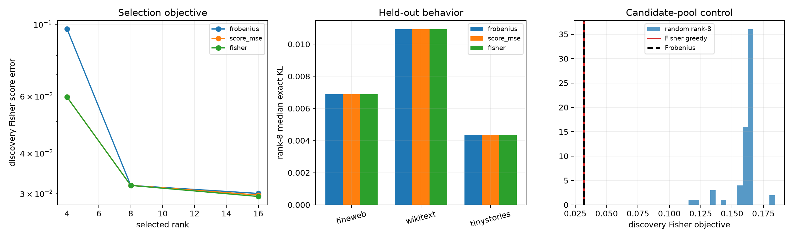

# Downstream-Fisher selection of the Layer-17 tail basis

The tensor, covariance transform, four-output tail space, candidate pool, and retained rank are fixed. Only the axis-selection objective changes: cleaned tensor Frobenius order, unweighted tail-score MSE, or the exact local softmax Fisher pulled back through final RMSNorm, unembedding, and logit tanh. Every selected program is evaluated by exact finite replacement of the native tail scores.

## Locked hypotheses

- **F1_fisher_selection_improves_discovery_objective: not supported.**
- **F2_fisher_rank8_improves_exact_kl: not supported.**
- **F3_fisher_rank16_reaches_behavioral_gate: not supported.**
- **F4_fisher_selection_beats_mse_selection: not supported.**
- **F5_fisher_selection_is_nontrivial: not supported.**
- **F6_fisher_selection_beats_random_subsets: supported.**

Fisher rank-8 axes: **[4, 1, 0, 3, 2, 5, 6, 7]**. Score-MSE rank-8 axes: **[1, 4, 3, 0, 2, 5, 6, 7]**. Frobenius rank-8 axes: **[0, 1, 2, 3, 4, 5, 6, 7]**.

| Corpus | Method | Rank-8 score R² | Rank-8 exact KL | Rank-16 exact KL |
|---|---|---:|---:|---:|
| fineweb | frobenius | 0.952 | 0.00689 | 0.00659 |
| fineweb | score_mse | 0.952 | 0.00689 | 0.00660 |
| fineweb | fisher | 0.952 | 0.00689 | 0.00655 |
| wikitext | frobenius | 0.969 | 0.01092 | 0.01048 |
| wikitext | score_mse | 0.969 | 0.01092 | 0.01044 |
| wikitext | fisher | 0.969 | 0.01092 | 0.01049 |
| tinystories | frobenius | 0.983 | 0.00435 | 0.00435 |
| tinystories | score_mse | 0.983 | 0.00435 | 0.00434 |
| tinystories | fisher | 0.983 | 0.00435 | 0.00425 |

| Method | Discovery rank-8 Fisher objective | Discovery rank-8 score MSE |
|---|---:|---:|
| frobenius | 3.1753e-02 | 5.6047e+06 |
| score_mse | 3.1753e-02 | 5.6047e+06 |
| fisher | 3.1753e-02 | 5.6047e+06 |

The Fisher objective is a local quadratic approximation around native final distributions; the reported KL is an exact finite recomputation. Improvement in the former without the latter would falsify local-metric sufficiency. Axis selection is restricted to a frozen 128D tensor-derived candidate pool, so failure would not rule out a continuously optimized subspace.
