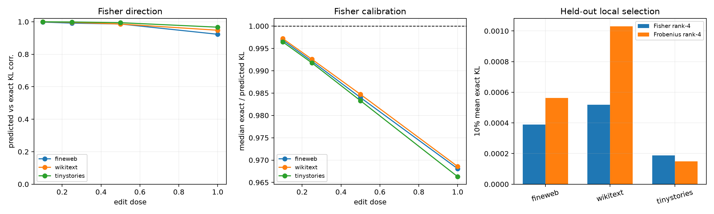

# Finite-dose red-team of the Layer-17 tail Fisher metric

The native-to-compact tail-score error is applied at 10%, 25%, 50%, and 100% dose. The local prediction is `0.5 * dose² * eᵀGe`, where `G` is the exact native softmax Fisher pulled back through final RMSNorm, unembedding, and logit tanh. Exact KL recomputes the full final distribution.

## Locked hypotheses

- **L1_fisher_predicts_local_kl_direction: supported.**
- **L2_fisher_locally_calibrated: supported.**
- **L3_fisher_predicts_full_replacement: supported.**
- **L4_fisher_rank4_beats_frobenius_locally: not supported.**
- **L5_local_kl_is_quadratic: supported.**

| Corpus | Variant | 10% corr. / calibration | 100% corr. / calibration | 100% median KL |
|---|---|---:|---:|---:|
| fineweb | fisher_rank4 | 0.998 / 1.00 | 0.924 / 0.96 | 0.01258 |
| fineweb | frobenius_rank4 | 0.998 / 1.00 | 0.908 / 0.96 | 0.00977 |
| fineweb | fisher_rank16 | 0.998 / 1.00 | 0.923 / 0.97 | 0.00654 |
| wikitext | fisher_rank4 | 0.999 / 1.00 | 0.939 / 0.97 | 0.01742 |
| wikitext | frobenius_rank4 | 0.999 / 1.00 | 0.908 / 0.96 | 0.01523 |
| wikitext | fisher_rank16 | 0.999 / 1.00 | 0.948 / 0.97 | 0.01049 |
| tinystories | fisher_rank4 | 0.999 / 1.00 | 0.955 / 0.97 | 0.01153 |
| tinystories | frobenius_rank4 | 0.999 / 1.00 | 0.891 / 0.97 | 0.00683 |
| tinystories | fisher_rank16 | 1.000 / 1.00 | 0.967 / 0.97 | 0.00425 |

If direction is predicted locally but calibration or ordering fails at full dose, Fisher remains a tangent explanation rather than a replacement objective. If Fisher-selected rank four loses even at 10% dose on held-out corpora, the discovery gain is sampling/metric overfit rather than merely finite-step curvature.
