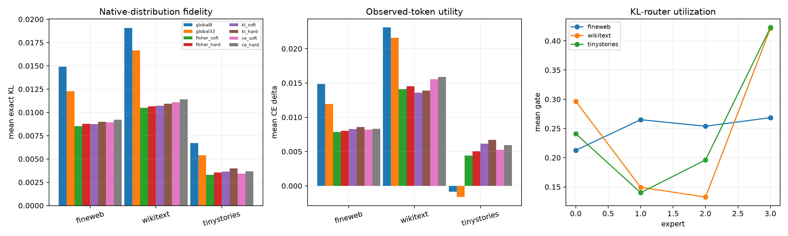

# Context-routed exact Layer-17 tail program

Four rank-eight tensor experts are routed from 32 frozen input coordinates. The program is trained first with pulled-back Fisher error, then cloned for exact native-distribution KL and KL-plus-observed-token-CE fine-tuning. Fixed global rank 8/32 and hard-routing controls use the same tensor pool.

## Locked hypotheses

- **C1_routing_beats_global32_local_fisher: supported.**
- **C2_exact_kl_router_beats_global32_ood: supported.**
- **C3_task_aware_router_improves_ce: not supported.**
- **C4_hard_routing_retains_gain: supported.**
- **C5_router_uses_multiple_experts: supported.**
- **C6_routed_rank8_reaches_behavioral_gate: supported.**
- **C7_exact_objective_improves_fisher_router: not supported.**

Opposite-half Fisher: routed **1.2158e-02**, global32 **1.7292e-02**.

| Corpus | Program | Mean KL | Median KL | CE Δ | Top1 |
|---|---|---:|---:|---:|---:|
| fineweb | global8 | 0.01491 | 0.00473 | 0.01487 | 0.938 |
| fineweb | global32 | 0.01229 | 0.00383 | 0.01195 | 0.947 |
| fineweb | fisher_soft | 0.00854 | 0.00205 | 0.00784 | 0.958 |
| fineweb | fisher_hard | 0.00877 | 0.00216 | 0.00803 | 0.957 |
| fineweb | kl_soft | 0.00874 | 0.00216 | 0.00829 | 0.958 |
| fineweb | kl_hard | 0.00900 | 0.00228 | 0.00856 | 0.957 |
| fineweb | ce_soft | 0.00894 | 0.00226 | 0.00819 | 0.956 |
| fineweb | ce_hard | 0.00920 | 0.00240 | 0.00832 | 0.955 |
| fineweb | KL router support | — | — | — | effective experts 3.98 |
| wikitext | global8 | 0.01907 | 0.00603 | 0.02309 | 0.928 |
| wikitext | global32 | 0.01664 | 0.00523 | 0.02158 | 0.932 |
| wikitext | fisher_soft | 0.01049 | 0.00272 | 0.01411 | 0.950 |
| wikitext | fisher_hard | 0.01066 | 0.00284 | 0.01451 | 0.949 |
| wikitext | kl_soft | 0.01072 | 0.00291 | 0.01358 | 0.949 |
| wikitext | kl_hard | 0.01093 | 0.00307 | 0.01390 | 0.949 |
| wikitext | ce_soft | 0.01109 | 0.00296 | 0.01553 | 0.948 |
| wikitext | ce_hard | 0.01140 | 0.00315 | 0.01590 | 0.946 |
| wikitext | KL router support | — | — | — | effective experts 3.58 |
| tinystories | global8 | 0.00670 | 0.00390 | -0.00085 | 0.948 |
| tinystories | global32 | 0.00539 | 0.00294 | -0.00164 | 0.955 |
| tinystories | fisher_soft | 0.00329 | 0.00148 | 0.00440 | 0.966 |
| tinystories | fisher_hard | 0.00354 | 0.00158 | 0.00505 | 0.964 |
| tinystories | kl_soft | 0.00365 | 0.00159 | 0.00616 | 0.965 |
| tinystories | kl_hard | 0.00398 | 0.00171 | 0.00671 | 0.963 |
| tinystories | ce_soft | 0.00343 | 0.00157 | 0.00525 | 0.966 |
| tinystories | ce_hard | 0.00368 | 0.00167 | 0.00593 | 0.963 |
| tinystories | KL router support | — | — | — | effective experts 3.68 |

A soft-only gain indicates an ensemble code, not sparse conditional execution. A hard-route gain with multiple balanced experts supports conditional compactness. Failure against global rank 32 supports a genuinely broad simultaneous residual or an inadequate linear router.
