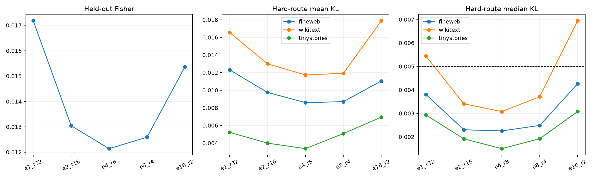

# Compute-matched routed granularity sweep

All programs have 32 total expert directions: one rank-32 expert through sixteen rank-2 experts. Only one expert executes under hard routing. Experts and a 32-coordinate linear router are trained on even FineWeb rows with Fisher error and validated on odd rows, then frozen for exact OOD interventions.

## Locked hypotheses

- **G1_conditional_program_beats_global32: supported.**
- **G2_best_granularity_is_interior: supported.**
- **G3_rank4_or_less_can_reach_gate: supported.**
- **G4_hard_execution_matches_soft: supported.**
- **G5_winner_transfers_across_corpora: supported.**
- **G6_conditional_gain_is_not_only_local: not supported.**

Geometric-mean hard-KL winner: **e4_r8**. Per-corpus winners: `{'fineweb': 'e4_r8', 'wikitext': 'e4_r8', 'tinystories': 'e4_r8'}`.

| Setting | Parameters | Active rank | Held-out Fisher | Geometric mean KL | fineweb hard/soft KL | wikitext hard/soft KL | tinystories hard/soft KL |
|---|---:|---:|---:|---:|---:|---:|---:|
| e1_r32 | 4129 | 32 | 1.7179e-02 | 0.01021 | 0.01231/0.01231 | 0.01655/0.01655 | 0.00522/0.00522 |
| e2_r16 | 4162 | 16 | 1.3041e-02 | 0.00797 | 0.00975/0.00972 | 0.01299/0.01293 | 0.00399/0.00390 |
| e4_r8 | 4228 | 8 | 1.2139e-02 | 0.00698 | 0.00859/0.00850 | 0.01173/0.01158 | 0.00337/0.00323 |
| e8_r4 | 4360 | 4 | 1.2590e-02 | 0.00808 | 0.00870/0.00842 | 0.01192/0.01137 | 0.00508/0.00463 |
| e16_r2 | 4624 | 2 | 1.5364e-02 | 0.01111 | 0.01105/0.00924 | 0.01788/0.01459 | 0.00694/0.00551 |

The sweep separates stored parameter budget from simultaneous execution rank. An interior hard-routing optimum supports conditional compactness; an endpoint optimum supports either one broad circuit or very fine discrete lookup.
