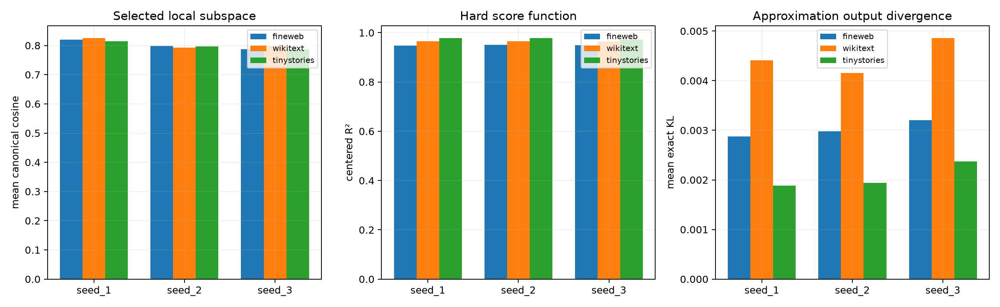

# Seed-invariant local subspace field

The discrete expert labels were not seed-stable. This test discards names and compares, at each identical context, the rank-eight subspace actually selected by each seed. Context-shuffled selections preserve each seed's expert usage and form the null. Hard predicted scores and exact output distributions are compared independently.

## Locked hypotheses

- **L1_selected_subspace_field_recurs: not supported.**
- **L2_selected_field_beats_context_shuffle: supported.**
- **L3_hard_score_function_recurs: supported.**
- **L4_output_function_recurs: not supported.**
- **L5_disagreement_sites_still_share_subspaces: supported.**
- **L6_field_is_more_canonical_than_labels: not supported.**

| Corpus | Seed | Selected overlap | Shuffled p95 | Disagreement overlap | Route-opt agreement | Score R² | Mean output KL |
|---|---|---:|---:|---:|---:|---:|---:|
| fineweb | seed_1 | 0.819 | 0.787 | 0.789 | 0.527 | 0.948 | 0.00287 |
| fineweb | seed_2 | 0.799 | 0.770 | 0.764 | 0.480 | 0.951 | 0.00298 |
| fineweb | seed_3 | 0.787 | 0.767 | 0.772 | 0.465 | 0.949 | 0.00320 |
| wikitext | seed_1 | 0.826 | 0.795 | 0.793 | 0.561 | 0.966 | 0.00441 |
| wikitext | seed_2 | 0.793 | 0.774 | 0.773 | 0.466 | 0.966 | 0.00416 |
| wikitext | seed_3 | 0.798 | 0.776 | 0.780 | 0.474 | 0.964 | 0.00486 |
| tinystories | seed_1 | 0.814 | 0.787 | 0.786 | 0.487 | 0.978 | 0.00188 |
| tinystories | seed_2 | 0.797 | 0.770 | 0.760 | 0.522 | 0.979 | 0.00194 |
| tinystories | seed_3 | 0.788 | 0.768 | 0.785 | 0.523 | 0.971 | 0.00238 |

If same-context selected subspaces recur while route labels do not, the canonical object is a smooth or overlapping local subspace field; the four experts are a useful quantization, not four unique modules.
