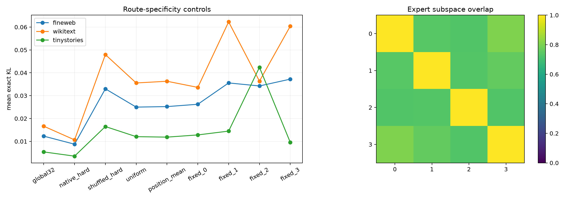

# Specificity controls for the routed Layer-17 tail program

The Fisher-trained four-by-eight program is frozen. Route assignments are shuffled, replaced by global or position-only means, made uniform, or removed by running each expert alone. All controls retain the same experts and exact final-logit intervention.

## Locked hypotheses

- **D1_context_assignment_matters: supported.**
- **D2_context_beats_position_only: supported.**
- **D3_no_single_expert_matches_router: supported.**
- **D4_experts_are_distinct_subspaces: supported.**
- **D5_hard_router_beats_global32: supported.**
- **D6_uniform_ensemble_is_insufficient: supported.**

Expert-subspace mean canonical cosine: **0.749** (range 0.727--0.806).

| Corpus | Program | Mean KL | Median KL | CE Δ | Top1 |
|---|---|---:|---:|---:|---:|
| fineweb | global32 | 0.01229 | 0.00383 | 0.01195 | 0.947 |
| fineweb | native_hard | 0.00877 | 0.00216 | 0.00803 | 0.957 |
| fineweb | shuffled_hard | 0.03299 | 0.00615 | 0.03274 | 0.920 |
| fineweb | uniform | 0.02499 | 0.00617 | 0.02556 | 0.929 |
| fineweb | global_mean | 0.02525 | 0.00608 | 0.02577 | 0.929 |
| fineweb | position_mean | 0.02522 | 0.00610 | 0.02573 | 0.928 |
| fineweb | position_hard | 0.03717 | 0.00530 | 0.03528 | 0.921 |
| fineweb | fixed_0 | 0.02623 | 0.00884 | 0.02782 | 0.922 |
| fineweb | fixed_1 | 0.03557 | 0.00631 | 0.03378 | 0.926 |
| fineweb | fixed_2 | 0.03424 | 0.00630 | 0.03635 | 0.913 |
| fineweb | fixed_3 | 0.03723 | 0.00481 | 0.03702 | 0.923 |
| wikitext | global32 | 0.01664 | 0.00523 | 0.02158 | 0.932 |
| wikitext | native_hard | 0.01066 | 0.00284 | 0.01451 | 0.949 |
| wikitext | shuffled_hard | 0.04796 | 0.00695 | 0.05132 | 0.909 |
| wikitext | uniform | 0.03555 | 0.00686 | 0.03535 | 0.914 |
| wikitext | global_mean | 0.03629 | 0.00678 | 0.03597 | 0.915 |
| wikitext | position_mean | 0.03630 | 0.00678 | 0.03600 | 0.915 |
| wikitext | position_hard | 0.05880 | 0.00628 | 0.06004 | 0.906 |
| wikitext | fixed_0 | 0.03362 | 0.01005 | 0.04293 | 0.908 |
| wikitext | fixed_1 | 0.06228 | 0.00957 | 0.05296 | 0.901 |
| wikitext | fixed_2 | 0.03635 | 0.00880 | 0.02087 | 0.908 |
| wikitext | fixed_3 | 0.06039 | 0.00475 | 0.06415 | 0.907 |
| tinystories | global32 | 0.00539 | 0.00294 | -0.00164 | 0.955 |
| tinystories | native_hard | 0.00354 | 0.00158 | 0.00505 | 0.964 |
| tinystories | shuffled_hard | 0.01649 | 0.00336 | 0.01882 | 0.942 |
| tinystories | uniform | 0.01207 | 0.00370 | 0.02002 | 0.944 |
| tinystories | global_mean | 0.01187 | 0.00365 | 0.01981 | 0.944 |
| tinystories | position_mean | 0.01186 | 0.00365 | 0.01978 | 0.945 |
| tinystories | position_hard | 0.01219 | 0.00272 | 0.01453 | 0.950 |
| tinystories | fixed_0 | 0.01282 | 0.00618 | 0.01328 | 0.935 |
| tinystories | fixed_1 | 0.01449 | 0.00435 | 0.02657 | 0.946 |
| tinystories | fixed_2 | 0.04239 | 0.00452 | 0.05474 | 0.921 |
| tinystories | fixed_3 | 0.00956 | 0.00226 | 0.00843 | 0.953 |

If shuffled, position-only, and fixed-expert controls lose the gain, the result is conditional circuit selection. If they match it, routing is merely an ensemble or positional lookup.
