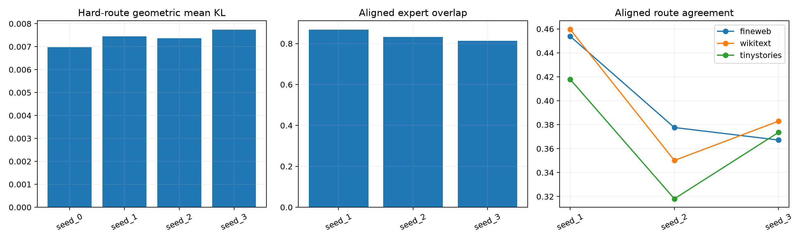

# Seed stability of the four-by-eight routed tail program

Four independently initialized programs use the same frozen tensor pool, data split, compute, and balancing objective. Experts are aligned by exhaustive permutation maximizing mean subspace canonical cosine; hard-route agreement is measured only after that alignment.

## Locked hypotheses

- **S1_performance_replicates: supported.**
- **S2_every_seed_beats_global32: not supported.**
- **S3_expert_subspaces_recur: supported.**
- **S4_routes_recur_in_distribution: not supported.**
- **S5_routes_recur_ood: not supported.**
- **S6_function_more_stable_than_coordinates: supported.**

Hard-KL geometric-mean coefficient of variation: **0.037**.

| Replicate | Held-out Fisher | Geometric mean KL | Expert overlap to seed 0 | FineWeb route agreement | WikiText | TinyStories |
|---|---:|---:|---:|---:|---:|---:|
| seed_0 | 1.2139e-02 | 0.00698 | 1.000 | 1.000 | 1.000 | 1.000 |
| seed_1 | 1.2188e-02 | 0.00745 | 0.868 | 0.454 | 0.460 | 0.418 |
| seed_2 | 1.1874e-02 | 0.00737 | 0.833 | 0.378 | 0.350 | 0.318 |
| seed_3 | 1.2413e-02 | 0.00774 | 0.814 | 0.367 | 0.383 | 0.374 |

Stable performance with unstable aligned experts would make conditional compactness canonical only at the function class level. Stable expert subspaces and routes would support reusable native-like conditional circuit identities.
