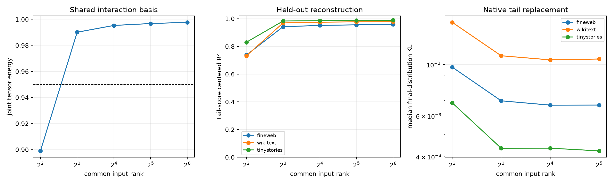

# Basis-invariant canonicalization of the Layer-17 residual-tail tensor

The stable residual tail is treated as one map from symmetric input interactions to a four-dimensional output subspace. Rotating the original tail PCs leaves this object unchanged. A FineWeb covariance metric defines cleaned forms; their 4×4 Frobenius Gram fixes tensor-canonical output coordinates, while the eigensystem of the sum of squared forms defines a shared input basis. The resulting Tucker-style program is evaluated on disjoint FineWeb and OOD states and inserted back into the native final residual path.

## Locked hypotheses

- **J1_canonical_output_axes_transfer: not supported.**
- **J2_joint_rank8_reconstructs_tail_scores: supported.**
- **J3_joint_rank16_near_exact_scores: not supported.**
- **J4_joint_rank16_behavioral_fidelity: not supported.**
- **J5_cross_terms_are_required: supported.**
- **J6_joint_rank16_captures_tensor_energy: supported.**

Tensor-canonical output energy fractions: **0.506, 0.237, 0.163, 0.094**.

| Common input rank | Joint clean tensor energy | FineWeb score R² | WikiText score R² | TinyStories score R² |
|---:|---:|---:|---:|---:|
| 4 | 0.899 | 0.737 | 0.732 | 0.830 |
| 8 | 0.990 | 0.942 | 0.969 | 0.983 |
| 16 | 0.995 | 0.951 | 0.975 | 0.986 |
| 32 | 0.997 | 0.956 | 0.977 | 0.987 |
| 64 | 0.998 | 0.959 | 0.979 | 0.988 |

| Corpus | Canonical-axis match | Rank-16 median corr. / R² | Diagonal-only R² | Rank-16 behavioral KL |
|---|---:|---:|---:|---:|
| fineweb | 0.993 | 0.965 / 0.951 | 0.350 | 0.00668 |
| wikitext | 0.954 | 0.977 / 0.975 | 0.371 | 0.01048 |
| tinystories | 0.772 | 0.987 / 0.986 | 0.330 | 0.00435 |

The common-rank program preserves the isotropic quadratic remainder exactly and compresses only the trace-cleaned interaction forms. Its output coordinates are canonical for the declared FineWeb covariance metric, not universal semantic axes. Cross-corpus axis matching tests metric stability; behavioral replacement tests whether score reconstruction survives final RMSNorm and the unembedding.
