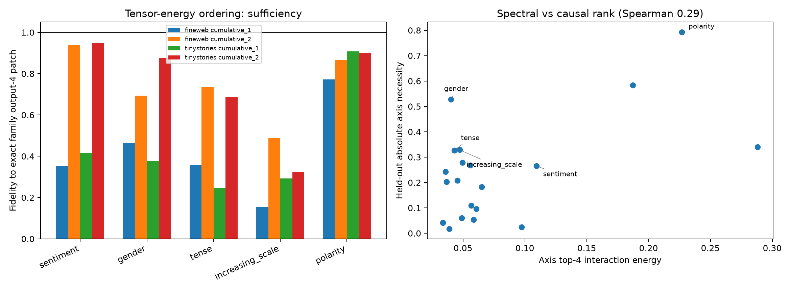

# Held-out causality of Layer-3 conditioned spectral axes

Canonical axes and input eigensystems are frozen from the weight analysis. They are evaluated on disjoint unseen lexical substitutions, with at most two natural contexts per pair and pair-balanced aggregation. Wrong semantic families and the five most spectrally concentrated canonicalized random output subspaces are controls.

## Locked hypotheses

- **A1_canonical_axes_exactly_recompose_family_patch: supported.**
- **A2_leading_axis_is_often_sufficient: not supported.**
- **A3_two_axes_are_often_sufficient: not supported.**
- **A4_family_subspaces_beat_exceptional_controls: supported.**
- **A5_rank64_modes_reproduce_unseen_family_effects: not supported.**
- **A6_spectral_concentration_predicts_causal_importance: not supported.**
- **A7_exceptional_axes_are_individually_necessary: supported.**
- **A8_family_patch_remains_partial: supported.**

| Corpus / family | Pairs | Axis 0 | Axes 0:2 | Spectral-16 | Spectral-64 | Best wrong | Best random | Full-MLP fidelity |
|---|---:|---:|---:|---:|---:|---:|---:|---:|
| fineweb / sentiment | 10 | 0.352 | 0.939 | 0.890 | 0.942 | 0.321 | 0.087 | 0.171 |
| fineweb / gender | 10 | 0.465 | 0.693 | 0.644 | 0.818 | 0.100 | 0.118 | 0.050 |
| fineweb / tense | 10 | 0.356 | 0.736 | 0.749 | 0.866 | 0.093 | 0.143 | 0.066 |
| fineweb / increasing_scale | 10 | 0.155 | 0.488 | 0.443 | 0.694 | -0.251 | 0.086 | -0.007 |
| fineweb / polarity | 10 | 0.773 | 0.865 | 0.760 | 0.847 | 0.293 | 0.149 | 0.143 |
| tinystories / sentiment | 7 | 0.415 | 0.950 | 0.952 | 0.979 | 0.432 | 0.108 | 0.160 |
| tinystories / gender | 5 | 0.376 | 0.875 | 0.799 | 0.939 | 0.197 | 0.085 | 0.247 |
| tinystories / tense | 7 | 0.247 | 0.685 | 0.632 | 0.835 | 0.228 | 0.134 | 0.051 |
| tinystories / increasing_scale | 6 | 0.293 | 0.323 | 0.707 | 0.809 | -0.418 | 0.205 | 0.028 |
| tinystories / polarity | 1 | 0.908 | 0.901 | 0.787 | 0.908 | 0.524 | 0.143 | 0.186 |

Across the 20 axes, top-four spectral concentration versus held-out absolute necessity has Spearman **0.293**.

Fidelity is measured relative to the exact output-4 family patch. Full-MLP fidelity is shown separately. An axis can faithfully reproduce or be necessary for that restricted patch while the parent patch remains a small part of the entire counterfactual computation.
