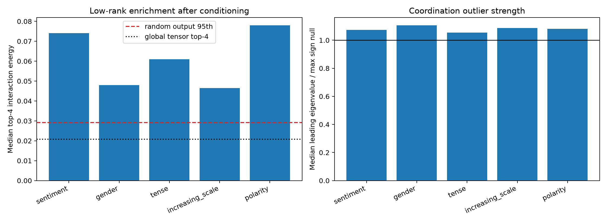

# Output-conditioned spectral spikes in Layer 3

Each frozen four-dimensional semantic-family output subspace is rotated into canonical directions by diagonalizing the exact tensor Frobenius Gram restricted to that subspace. This rotation uses weights after the family subspace has been frozen and cannot change the subspace. Each resulting output direction contracts the bilinear tensor into an exact symmetric input interaction matrix. Its spectrum is compared with channel-sign nulls and isotropic random output directions.

## Locked hypotheses

- **P1_weight_canonicalization_is_exact: supported.**
- **P2_conditioned_axes_are_coordination_outliers: supported.**
- **P3_conditioning_enriches_low_rank_forms: supported.**
- **P4_conditioned_powerlaw_spikes_are_common: not supported.**
- **P5_every_family_has_an_exceptional_axis: supported.**
- **P6_family_conditioning_beats_global_concentration: supported.**

| Family | Median top-4 energy | Median leading/null-max | Axes beating all nulls | Axes with strict fitted spike |
|---|---:|---:|---:|---:|
| sentiment | 0.074 | 1.073 | 4/4 | 0/4 |
| gender | 0.048 | 1.106 | 4/4 | 0/4 |
| tense | 0.061 | 1.054 | 4/4 | 1/4 |
| increasing_scale | 0.046 | 1.087 | 4/4 | 0/4 |
| polarity | 0.078 | 1.082 | 4/4 | 1/4 |

The random-output 95th percentile top-four energy is **0.029**; the global Layer-3 tensor-map top-four energy is **0.021**.

A null-exceeding conditioned axis is an exceptional interaction form relative to the tested coordination null. It is not automatically a complete semantic circuit: the family output subspace was discovered from data, and prior finite interventions show that these rank-four output projections explain only a minority of the complete MLP effect. Conversely, failure of a fitted positive power-law excess does not erase causal semantic structure already validated in the same family.
