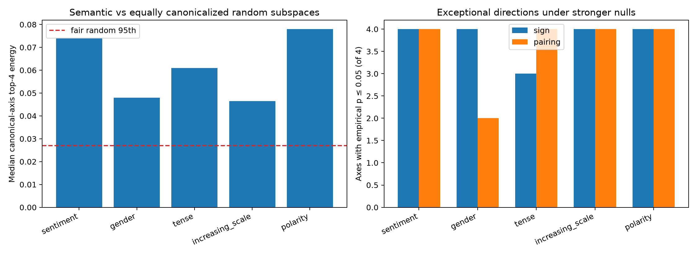

# Red-team of output-conditioned Layer-3 spikes

This follow-up was locked after the initial positive result. It raises each channel-coordination null from eight to 64 draws, adds a coefficient-to-form pairing null, and gives 64 random four-dimensional output subspaces the same tensor-Frobenius canonicalization used for semantic families.

## Locked hypotheses

- **R1_all_initial_sign_outliers_survive: not supported.**
- **R2_families_survive_two_null_types: supported.**
- **R3_semantic_subspaces_beat_fair_random_subspaces: supported.**
- **R4_enrichment_is_not_only_the_energy_leading_axis: supported.**
- **R5_the_strict_powerlaw_rule_remains_low_recall: supported.**

| Family | Median top-4 | Fair-random p | Tail top-4 | Tail-random p | Robust sign axes | Robust pairing axes | Robust under both |
|---|---:|---:|---:|---:|---:|---:|---:|
| sentiment | 0.074 | 0.015 | 0.039 | 0.015 | 4/4 | 4/4 | 4/4 |
| gender | 0.048 | 0.015 | 0.056 | 0.015 | 4/4 | 2/4 | 2/4 |
| tense | 0.061 | 0.015 | 0.065 | 0.015 | 3/4 | 4/4 | 3/4 |
| increasing_scale | 0.046 | 0.015 | 0.046 | 0.015 | 4/4 | 4/4 | 4/4 |
| polarity | 0.078 | 0.015 | 0.059 | 0.015 | 4/4 | 4/4 | 4/4 |

The fair-random 95th percentiles are **0.027** for all four axes and **0.028** after excluding the tensor-energy-leading axis.

This distinguishes exceptional learned coordination from low rank caused merely by choosing and canonicalizing a four-dimensional output subspace. Empirical p-values are resolution-limited to 1/65 and apply to the specified null generators, not to every conceivable random-tensor ensemble.
