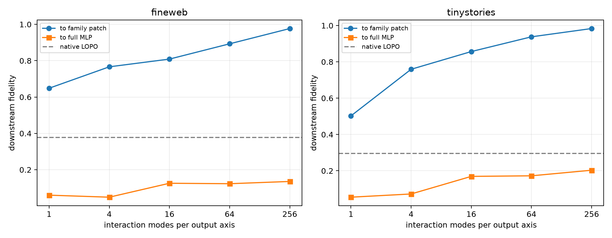

# Family-conditioned Layer-3 interaction modes

For each lexical query, a four-dimensional family output subspace is learned from the other FineWeb pairs in that family. Each output axis contracts the exact Layer-3 tensor to a symmetric input interaction matrix; its eigenmodes are truncated and evaluated in the complete suffix. Native leave-one-pair-out channels, a global output basis, and every wrong-family output basis are controls.

## Locked hypotheses

- **Q1_family_forms_are_exact: supported.**
- **Q2_family_output4_is_causally_substantial: not supported.**
- **Q3_rank64_interactions_recover_family_patch: supported.**
- **Q4_rank256_interactions_nearly_recover_family_patch: supported.**
- **Q5_spectral256_beats_native_family_addresses: not supported.**
- **Q6_family_output_basis_beats_global_basis: supported.**
- **Q7_family_output_basis_is_semantically_specific: supported.**

| Corpus | Route | Full-MLP fidelity | Family-patch fidelity | Full-MLP cosine | Semantic projection |
|---|---|---:|---:|---:|---:|
| fineweb | family_exact | 0.118 | 1.000 | 0.522 | 0.014 |
| fineweb | global_exact | 0.030 | -0.131 | 0.177 | 0.004 |
| fineweb | wrong_family_median | 0.008 | -0.268 | 0.098 | 0.000 |
| fineweb | wrong_family_best | 0.101 | 0.035 | 0.488 | 0.020 |
| fineweb | native_lopo | 0.378 | -2.496 | 0.755 | 0.051 |
| fineweb | spectral_1 | 0.060 | 0.649 | 0.374 | 0.003 |
| fineweb | spectral_4 | 0.049 | 0.766 | 0.524 | 0.012 |
| fineweb | spectral_16 | 0.126 | 0.809 | 0.564 | 0.013 |
| fineweb | spectral_64 | 0.123 | 0.893 | 0.562 | 0.013 |
| fineweb | spectral_256 | 0.136 | 0.977 | 0.559 | 0.014 |
| tinystories | family_exact | 0.188 | 1.000 | 0.612 | 0.047 |
| tinystories | global_exact | 0.088 | 0.149 | 0.487 | 0.014 |
| tinystories | wrong_family_median | 0.038 | 0.015 | 0.255 | 0.010 |
| tinystories | wrong_family_best | 0.086 | 0.087 | 0.569 | 0.015 |
| tinystories | native_lopo | 0.295 | -0.626 | 0.668 | 0.047 |
| tinystories | spectral_1 | 0.055 | 0.502 | 0.535 | 0.008 |
| tinystories | spectral_4 | 0.072 | 0.759 | 0.617 | 0.013 |
| tinystories | spectral_16 | 0.169 | 0.857 | 0.647 | 0.030 |
| tinystories | spectral_64 | 0.172 | 0.938 | 0.591 | 0.031 |
| tinystories | spectral_256 | 0.203 | 0.983 | 0.610 | 0.037 |

Maximum exact family-form reconstruction error: `2.61e-06`.

This test separates two possible reusable objects: a fixed subset of native product addresses and a learned family output subspace whose input computation is represented by quadratic eigenmodes. Neither is a complete semantic circuit unless it also beats global and wrong-family controls and explains a substantial part of the full MLP effect.
