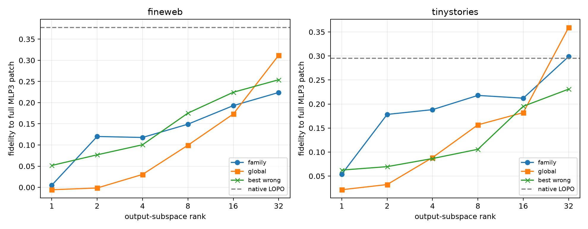

# Layer-3 family output-rank sweep

Leave-one-pair-out family and global output subspaces are swept from rank 1 to 32. All other family bases are evaluated at each rank, and the strongest wrong family is retained as an adversarial specificity control. The native family-channel patch is unchanged.

## Locked hypotheses

- **O1_family_rank32_is_substantial: not supported.**
- **O2_family_rank32_matches_native_addresses: not supported.**
- **O3_family_rank16_is_semantically_specific: not supported.**
- **O4_family_rank32_is_semantically_specific: not supported.**
- **O5_family_rank16_beats_global: not supported.**
- **O6_family_rank32_transfers_ood: supported.**

| Corpus | Rank | Family | Global | Best wrong family | Family local fidelity |
|---|---:|---:|---:|---:|---:|
| fineweb | 1 | 0.005 | -0.006 | 0.052 | 0.006 |
| fineweb | 2 | 0.120 | -0.002 | 0.077 | 0.028 |
| fineweb | 4 | 0.118 | 0.030 | 0.101 | 0.036 |
| fineweb | 8 | 0.149 | 0.099 | 0.175 | 0.051 |
| fineweb | 16 | 0.193 | 0.173 | 0.225 | 0.087 |
| fineweb | 32 | 0.224 | 0.312 | 0.254 | 0.124 |
| fineweb | native-256 | 0.378 | — | — | — |
| tinystories | 1 | 0.054 | 0.022 | 0.062 | 0.010 |
| tinystories | 2 | 0.178 | 0.032 | 0.070 | 0.049 |
| tinystories | 4 | 0.188 | 0.088 | 0.086 | 0.083 |
| tinystories | 8 | 0.218 | 0.157 | 0.106 | 0.105 |
| tinystories | 16 | 0.212 | 0.182 | 0.195 | 0.141 |
| tinystories | 32 | 0.299 | 0.359 | 0.231 | 0.176 |
| tinystories | native-256 | 0.295 | — | — | — |

Increasing output rank asks whether the clean rank-4 semantic core was merely too narrow. A family basis that becomes behaviorally strong while retaining advantages over global and wrong-family bases is a reusable distributed code; loss of those advantages means the additional dimensions are generic edit transport rather than family-specific computation.
