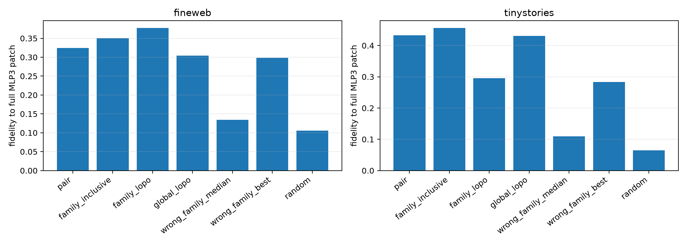

# Leave-one-pair-out red team of Layer-3 family channels

For every query, the family and global channel rankings are rebuilt without the discovery example for that lexical pair. All other semantic-family sets are evaluated separately; their per-query median and strongest downstream fidelities are reported. This separates family reuse from same-pair recurrence.

## Locked hypotheses

- **E1_lopo_family_transfers: supported.**
- **E2_lopo_family_beats_random: supported.**
- **E3_lopo_family_beats_median_wrong_family: supported.**
- **E4_lopo_family_beats_best_wrong_family: supported.**
- **E5_lopo_family_beats_lopo_global: not supported.**
- **E6_lopo_family_transfers_ood: supported.**
- **E7_lopo_support_is_nonrandom: supported.**
- **E8_same_pair_leakage_is_limited: not supported.**

| Corpus | Route | Local fidelity | Downstream fidelity | Downstream cosine | Target projection | Oracle support Jaccard |
|---|---|---:|---:|---:|---:|---:|
| fineweb | oracle | 0.571 | 0.646 | 0.854 | 0.171 | — |
| fineweb | pair | 0.288 | 0.324 | 0.587 | 0.064 | 0.096 |
| fineweb | family_inclusive | 0.318 | 0.351 | 0.662 | 0.054 | 0.106 |
| fineweb | family_lopo | 0.281 | 0.378 | 0.755 | 0.051 | 0.082 |
| fineweb | global_lopo | 0.255 | 0.304 | 0.718 | 0.051 | 0.073 |
| fineweb | wrong_family_median | 0.090 | 0.134 | 0.463 | 0.014 | — |
| fineweb | wrong_family_best | 0.087 | 0.298 | 0.717 | 0.057 | — |
| fineweb | random | 0.075 | 0.106 | 0.444 | 0.014 | 0.030 |
| tinystories | oracle | 0.605 | 0.713 | 0.889 | 0.248 | — |
| tinystories | pair | 0.278 | 0.433 | 0.766 | 0.092 | 0.111 |
| tinystories | family_inclusive | 0.276 | 0.456 | 0.755 | 0.089 | 0.128 |
| tinystories | family_lopo | 0.265 | 0.295 | 0.668 | 0.047 | 0.087 |
| tinystories | global_lopo | 0.248 | 0.431 | 0.703 | 0.066 | 0.076 |
| tinystories | wrong_family_median | 0.100 | 0.109 | 0.471 | 0.018 | — |
| tinystories | wrong_family_best | 0.115 | 0.283 | 0.685 | 0.037 | — |
| tinystories | random | 0.084 | 0.065 | 0.343 | 0.015 | 0.032 |

## Family heterogeneity (downstream fidelity)

| Corpus | Family | Pair | Family LOPO | Global LOPO | Median wrong | Best wrong | Random |
|---|---|---:|---:|---:|---:|---:|---:|
| fineweb | sentiment | 0.411 | 0.439 | 0.375 | 0.255 | 0.517 | 0.154 |
| fineweb | gender | 0.114 | 0.366 | 0.099 | 0.040 | 0.147 | 0.139 |
| fineweb | tense | 0.393 | 0.616 | 0.368 | 0.063 | 0.209 | 0.029 |
| fineweb | increasing_scale | 0.235 | -0.039 | 0.167 | 0.143 | 0.277 | 0.100 |
| fineweb | polarity | 0.484 | 0.531 | 0.507 | 0.272 | 0.573 | 0.131 |
| tinystories | sentiment | 0.562 | 0.469 | 0.448 | 0.221 | 0.432 | 0.014 |
| tinystories | gender | 0.472 | 0.374 | 0.334 | 0.034 | 0.099 | 0.040 |
| tinystories | tense | 0.436 | 0.264 | 0.261 | 0.103 | 0.239 | 0.164 |
| tinystories | increasing_scale | 0.206 | 0.109 | 0.120 | 0.061 | 0.117 | 0.097 |
| tinystories | polarity | 0.505 | 0.476 | 0.458 | 0.204 | 0.457 | 0.048 |

A positive leave-one-pair-out result supports a family-reused native address set, but not a complete family circuit: the selected current-example channel deltas may still depend on lexical and contextual directions upstream. Comparison with the global set tests whether semantic grouping adds information beyond generally high-utility channels.
The aggregate family result is heterogeneous: increasing-scale fails even in-domain, while polarity and sentiment can be matched or exceeded by the best wrong family. Family labels therefore identify useful reusable address priors, not mutually exclusive native modules.
