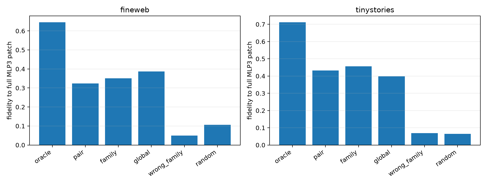

# Frozen native-channel transfer at Layer 3

Native product channels are ranked only on FineWeb context 1. Pair-, family-, and global-level top-256 sets are then frozen and used to select the current query's product deltas on disjoint context 0 in FineWeb and TinyStories. Per-example oracle selection is a ceiling; cyclic wrong-family and fixed global/random sets are controls.

## Locked hypotheses

- **D1_oracle256_reproduces_mlp3_effect: supported.**
- **D2_pair_channels_transfer: supported.**
- **D3_pair_beats_random: supported.**
- **D4_family_beats_random: supported.**
- **D5_family_is_semantically_specific: supported.**
- **D6_family_beats_global: not supported.**
- **D7_family_transfers_ood: supported.**
- **D8_frozen_support_is_nonrandom: supported.**

| Corpus | Route | Local fidelity | Downstream fidelity | Downstream cosine | Semantic target projection | Oracle support Jaccard |
|---|---|---:|---:|---:|---:|---:|
| fineweb | oracle | 0.571 | 0.646 | 0.854 | 0.171 | 1.000 |
| fineweb | pair | 0.288 | 0.324 | 0.587 | 0.064 | 0.096 |
| fineweb | family | 0.318 | 0.350 | 0.662 | 0.054 | 0.106 |
| fineweb | global | 0.275 | 0.387 | 0.651 | 0.056 | 0.085 |
| fineweb | wrong_family | 0.078 | 0.050 | 0.322 | 0.006 | 0.036 |
| fineweb | random | 0.075 | 0.106 | 0.444 | 0.014 | 0.030 |
| tinystories | oracle | 0.605 | 0.713 | 0.889 | 0.248 | 1.000 |
| tinystories | pair | 0.278 | 0.432 | 0.766 | 0.092 | 0.111 |
| tinystories | family | 0.276 | 0.456 | 0.755 | 0.089 | 0.128 |
| tinystories | global | 0.276 | 0.399 | 0.715 | 0.070 | 0.092 |
| tinystories | wrong_family | 0.073 | 0.069 | 0.377 | 0.006 | 0.041 |
| tinystories | random | 0.084 | 0.065 | 0.341 | 0.015 | 0.032 |

The frozen sets patch the current example's own product changes; they never copy counterfactual activations from discovery examples. Thus success means a stable native address set, not merely activation similarity. Failure can mean that reusable computation lives in a rotated interaction subspace rather than in fixed native channels.
