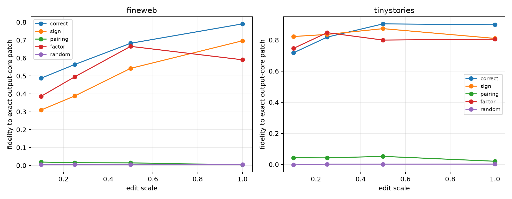

# Causal-null and scale red team for Layer-3 family input forms

For every leave-one-pair-out bank, four sign and four Down/form-pairing null metrics are generated. The null with greatest rank-32 overlap to the observed metric is selected before causal evaluation. An unweighted Left/Right factor-span basis and random basis are additional controls. Each basis receives the same projected natural state change at scales 0.1--1.0, after which the exact bank and model suffix are recomputed.

## Locked hypotheses

- **J1_top4_beats_adversarial_sign_null: not supported.**
- **J2_top4_beats_adversarial_pairing_null: supported.**
- **J3_top4_beats_unweighted_factor_span: not supported.**
- **J4_top4_survives_tangent_regime: not supported.**
- **J5_top32_is_stable_across_scale: supported.**
- **J6_top4_is_not_just_delta_energy: supported.**
- **J7_null_redteam_transfers_ood: supported.**

| Corpus | Scale | Correct-4 | Sign-4 | Pairing-4 | Factor-4 | Random-4 | Correct-32 |
|---|---:|---:|---:|---:|---:|---:|---:|
| fineweb | 0.10 | 0.487 | 0.310 | 0.019 | 0.386 | 0.005 | 0.949 |
| fineweb | 0.25 | 0.564 | 0.388 | 0.015 | 0.495 | 0.005 | 0.960 |
| fineweb | 0.50 | 0.682 | 0.542 | 0.014 | 0.665 | 0.005 | 0.963 |
| fineweb | 1.00 | 0.791 | 0.696 | 0.003 | 0.590 | 0.005 | 0.976 |

Rank-4 state-delta energy captured (correct/sign/pairing/factor/random): **0.033 / 0.032 / 0.006 / 0.072 / 0.003**.
Adversarial sign/pairing rank-32 overlap with observed: **0.896 / 0.244**.

| tinystories | 0.10 | 0.718 | 0.823 | 0.043 | 0.746 | -0.003 | 0.959 |
| tinystories | 0.25 | 0.819 | 0.836 | 0.042 | 0.847 | 0.002 | 0.956 |
| tinystories | 0.50 | 0.904 | 0.873 | 0.052 | 0.800 | 0.002 | 0.958 |
| tinystories | 1.00 | 0.898 | 0.810 | 0.021 | 0.805 | 0.002 | 0.967 |

Rank-4 state-delta energy captured (correct/sign/pairing/factor/random): **0.051 / 0.042 / 0.005 / 0.057 / 0.004**.
Adversarial sign/pairing rank-32 overlap with observed: **0.896 / 0.244**.

The scale sweep separates a stable tangent discrimination from a full-edit curvature artifact. The adversarial nulls test whether the causal subspace follows learned Down-to-form coordination or merely the selected channels' generic input geometry.
