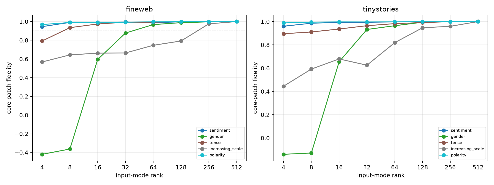

# Per-family causal K90 of Layer-3 input forms

The correct family-bank input eigenspace is swept through rank 512. `Causal K90` is the first tested rank whose median held-out downstream fidelity to the exact four-axis output-core patch reaches 0.90. It is reported separately by semantic family, corpus, and 10% versus full edit scale.

## Locked hypotheses

- **K1_gender_reaches_k90_by64: supported.**
- **K2_increasing_scale_reaches_k90_by128: not supported.**
- **K3_every_family_reaches_k90_by128: not supported.**
- **K4_full_scale_k90_is_ood_stable: supported.**
- **K5_tangent_rank_is_comparable: not supported.**

| Corpus | Family | K90 at 10% | K90 at 100% | Fidelity curve at 100% (ranks 4→512) |
|---|---|---:|---:|---|
| fineweb | sentiment | 32 | 4 | 0.946, 0.991, 0.991, 0.995, 0.989, 0.997, 0.999, 1.000 |
| fineweb | gender | 64 | 64 | -0.420, -0.364, 0.595, 0.877, 0.968, 0.989, 0.997, 1.000 |
| fineweb | tense | 8 | 8 | 0.792, 0.935, 0.974, 0.993, 0.994, 0.998, 0.999, 1.000 |
| fineweb | increasing_scale | 256 | 256 | 0.568, 0.643, 0.662, 0.664, 0.746, 0.793, 0.976, 1.000 |
| fineweb | polarity | 4 | 4 | 0.968, 0.990, 0.989, 0.993, 0.997, 0.999, 1.000, 1.000 |
| tinystories | sentiment | 4 | 4 | 0.960, 0.986, 0.993, 0.994, 0.997, 0.999, 1.000, 1.000 |
| tinystories | gender | 64 | 32 | -0.140, -0.129, 0.655, 0.932, 0.964, 0.994, 0.999, 1.000 |
| tinystories | tense | 16 | 8 | 0.896, 0.911, 0.936, 0.965, 0.982, 0.992, 0.999, 1.000 |
| tinystories | increasing_scale | 128 | 128 | 0.445, 0.592, 0.679, 0.625, 0.819, 0.947, 0.959, 1.000 |
| tinystories | polarity | 4 | 4 | 0.988, 0.995, 0.997, 0.997, 0.998, 1.000, 1.000, 1.000 |

A low K90 is a use-case-specific notion of mechanistic simplicity: how many weight-derived input directions are sufficient for this family’s clean output core under a declared intervention. It is not a neuron count and does not measure the rank needed for the entire MLP write or language-model behavior.
