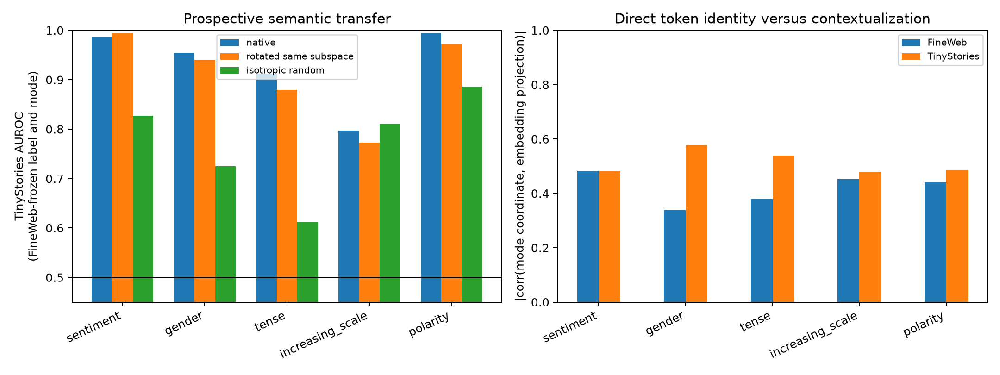

# Natural semantic labels for frozen Layer-3 input modes

The family channel banks and their bilinear input metrics are frozen before this run. FineWeb selects a current-token predicate, signed-versus-magnitude signal, orientation, and one of eight modes. The unchanged explanation is evaluated on TinyStories. A random rotation tests whether semantics belong to the family subspace rather than its native eigenvectors; isotropic random directions, wrong families, and generic token-form labels test weaker alternatives.

## Locked hypotheses

- **S1_every_family_has_semantic_mode: supported.**
- **S2_semantic_modes_beat_random: supported.**
- **S3_family_labels_are_specific: not supported.**
- **S4_weight_axes_predict_natural_coordinates: supported.**
- **S5_labels_transfer_ood: supported.**
- **S6_semantics_exceed_generic_token_form: not supported.**
- **S7_family_tokens_are_weight_neighbours: not supported.**
- **S8_native_axes_are_more_semantic_than_rotations: not supported.**

FineWeb sites: **524,288**; TinyStories sites: **153,600**.

| Family | Native mode | Frozen label | Signal | Fine AUROC | Tiny AUROC | Wrong | Generic | Rotated | Random | |embed corr| Fine/Tiny | Seed rank |
|---|---:|---|---|---:|---:|---:|---:|---:|---:|---:|---:|
| sentiment | 0 | family:sentiment:target | signed | 0.985 | 0.986 | 0.773 | n/a | 0.995 | 0.827 | 0.483/0.481 | 7 |
| gender | 3 | family:gender:source | signed | 0.981 | 0.955 | 0.573 | n/a | 0.940 | 0.725 | 0.338/0.578 | 1 |
| tense | 1 | family:tense:target | magnitude | 0.957 | 0.912 | 0.591 | 0.868 | 0.879 | 0.611 | 0.380/0.539 | 19 |
| increasing_scale | 3 | family:increasing_scale:target | magnitude | 0.687 | 0.797 | 0.990 | n/a | 0.772 | 0.810 | 0.452/0.479 | 2033 |
| polarity | 3 | family:polarity:target | signed | 0.990 | 0.994 | 0.920 | n/a | 0.972 | 0.886 | 0.440/0.486 | 13 |

A high current-token AUROC identifies a lexical coordinate, not the complete family interaction program. A rotated-subspace match would mean the family subspace is semantic but its individual eigenvectors are not uniquely privileged. Low embedding correlation with preserved AUROC would instead indicate a contextual transformation rather than simple survival of the repeatedly injected token embedding. Full nearest-token lists, positive/negative natural-context tails, all mode records, and frozen controls are in `layer3_input_mode_semantics.json`.

The locked generic-token-form hypothesis is not supported and is partly non-adjudicative: for four representatives FineWeb selected a rare generic category with zero TinyStories positives, shown as `n/a`. This is retained as a failed prospective control rather than silently replacing the label after inspecting the evaluation corpus.
