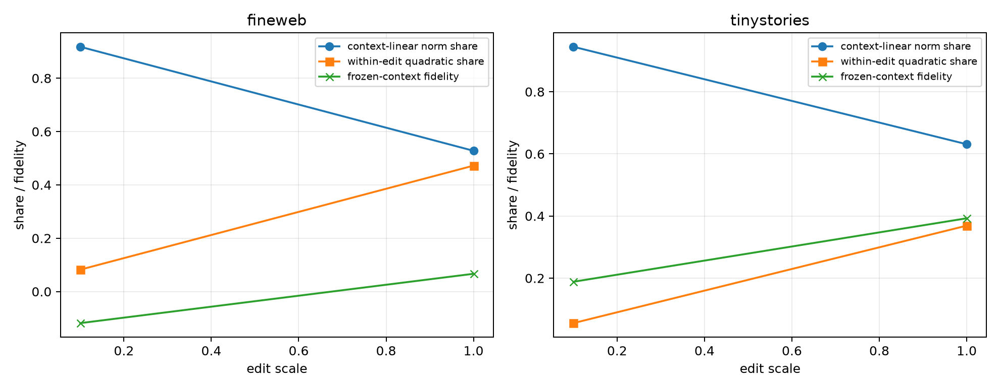

# Exact polynomial split of Layer-3 family input circuits

For each family, the input rank is set to the worst-case causal rank suggested by the preceding sweep. For a projected edit `δ=Vz`, every output-core form obeys the exact identity `Δq = 2 δᵀAx + δᵀAδ`. The first term is a context-conditioned linear discrimination; the second is interaction among changed directions. Replacing `x` with the leave-one-pair-out discovery mean tests whether current context is necessary.

## Locked hypotheses

- **L1_polynomial_split_is_exact: not supported.**
- **L2_tangent_effect_is_context_linear: supported.**
- **L3_full_effect_is_mostly_context_linear: not supported.**
- **L4_linear_term_is_behaviorally_sufficient: not supported.**
- **L5_quadratic_term_is_nontrivial: supported.**
- **L6_current_context_is_necessary: supported.**
- **L7_polynomial_regime_transfers_ood: supported.**

| Corpus | Scale | Linear / quadratic norm share | Linear fidelity | Quadratic fidelity | Frozen-context fidelity | L/Q cosine |
|---|---:|---:|---:|---:|---:|---:|
| fineweb | 0.10 | 0.918 / 0.082 | 0.990 | 0.023 | -0.118 | -0.245 |
| fineweb | 1.00 | 0.528 / 0.472 | 0.337 | 0.266 | 0.067 | -0.245 |
| tinystories | 0.10 | 0.945 / 0.055 | 0.998 | 0.008 | 0.188 | -0.079 |
| tinystories | 1.00 | 0.631 / 0.369 | 0.854 | 0.241 | 0.393 | -0.079 |

Maximum exact polynomial reconstruction error: `2.14e-05`.
The same identity evaluated directly in float64 has maximum relative error `5.15e-14`; the maximum float32-bank versus float64-form discrepancy is `2.15e-05`.
The locked float32 threshold therefore remains formally missed, while the algebraic identity is independently verified and the miss is localized to finite-precision cancellation.

## Family regimes at full edit scale

| Corpus | Family | Input rank | Linear norm share | Linear fidelity | Frozen-context fidelity |
|---|---|---:|---:|---:|---:|
| fineweb | sentiment | 32 | 0.575 | 0.459 | 0.710 |
| fineweb | gender | 64 | 0.471 | 0.414 | 0.320 |
| fineweb | tense | 16 | 0.573 | -0.792 | -0.101 |
| fineweb | increasing_scale | 256 | 0.511 | 0.381 | -0.699 |
| fineweb | polarity | 4 | 0.623 | 0.758 | 0.509 |
| tinystories | sentiment | 32 | 0.674 | 0.906 | 0.550 |
| tinystories | gender | 64 | 0.414 | 0.670 | 0.659 |
| tinystories | tense | 16 | 0.538 | 0.516 | 0.133 |
| tinystories | increasing_scale | 256 | 0.605 | 0.808 | -0.973 |
| tinystories | polarity | 4 | 0.775 | 0.922 | 0.393 |

The stable quadratic tensor is only part of the executable mechanism. Its response to a particular edit is dominated or modified by the cross term with the current residual context; therefore a weight-only circuit and a context-conditioned local program are complementary descriptions rather than competitors.
