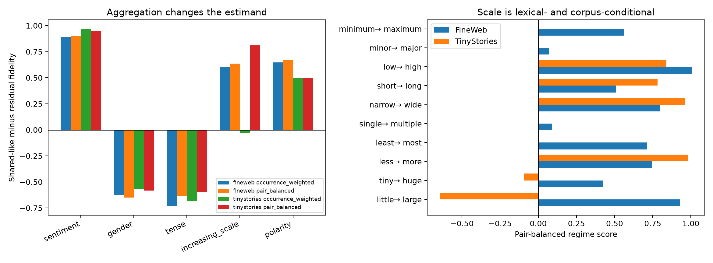

# Hierarchical red-team of Layer-3 causal regime labels

This is a post-hoc aggregation diagnostic. Positive values mean the frozen shared-like eight-dimensional route better reproduces the family's top-32 patch; negative values favor the residual 24. Occurrence weighting asks about a typical occurrence in the sampled corpus. Pair balancing asks about a typical frozen lexical contrast. Neither is universally privileged.

| Corpus / family | Contexts / pairs | Occurrence median | Pair-balanced median [95% pair bootstrap] | Positive pairs | Within-pair sign consistency |
|---|---:|---:|---:|---:|---:|
| fineweb / sentiment | 60 / 10 | 0.888 | 0.900 [0.837, 0.975] | 1.00 | 1.00 |
| fineweb / gender | 60 / 10 | -0.626 | -0.649 [-0.762, -0.465] | 0.00 | 1.00 |
| fineweb / tense | 60 / 10 | -0.733 | -0.634 [-0.960, -0.506] | 0.00 | 1.00 |
| fineweb / increasing_scale | 60 / 10 | 0.599 | 0.636 [0.300, 0.836] | 1.00 | 0.83 |
| fineweb / polarity | 60 / 10 | 0.646 | 0.674 [0.427, 0.806] | 1.00 | 1.00 |
| tinystories / sentiment | 42 / 7 | 0.970 | 0.951 [0.888, 1.081] | 1.00 | 1.00 |
| tinystories / gender | 25 / 5 | -0.570 | -0.584 [-0.793, -0.564] | 0.00 | 1.00 |
| tinystories / tense | 29 / 7 | -0.685 | -0.595 [-0.879, -0.215] | 0.00 | 1.00 |
| tinystories / increasing_scale | 17 / 6 | -0.029 | 0.811 [-0.369, 0.972] | 0.67 | 1.00 |
| tinystories / polarity | 6 / 1 | 0.498 | 0.498 [0.498, 0.498] | 1.00 | 1.00 |

## What survives the red-team

FineWeb sentiment and polarity are unanimously shared-like across lexical pairs; gender and tense are unanimously residual-like. These four signs also hold for every available TinyStories pair. Scale is different: all ten FineWeb pairs are shared-like in median, but TinyStories contains both shared-like and residual-like scale pairs. Its occurrence-weighted and pair-balanced summaries differ sharply because frequent words dominate the former.

The family label is therefore a useful prior, not a complete causal type. A regime label needs an explicit sampling unit: token occurrences for expected corpus behavior, lexical pairs for vocabulary-level claims, and individual contexts for mechanistic universality. The bootstrap intervals quantify lexical sampling only; they do not turn the manually selected lexicon into a population-random sample.
