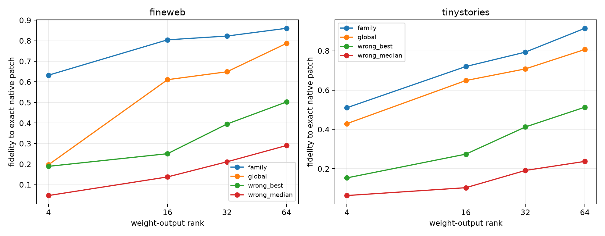

# Specificity of Layer-3 native-bank output axes

The exact current write of each leave-one-pair-out family bank is projected into weight-SVD bases from that bank, a global channel bank, and every wrong-family bank. This holds the native write fixed and asks whether the compressed output axes themselves are family-specific.

## Locked hypotheses

- **P1_family_basis_beats_global_at32: supported.**
- **P2_family_basis_beats_best_wrong_at32: supported.**
- **P3_family_rank64_nearly_recovers_native_bank: not supported.**
- **P4_family_rank64_preserves_full_mlp_relevance: not supported.**
- **P5_family_and_global_axes_are_distinct: supported.**
- **P6_basis_specificity_transfers_ood: supported.**

| Corpus | Rank | Family | Global | Best wrong | Median wrong | Family/global canonical cosine |
|---|---:|---:|---:|---:|---:|---:|
| fineweb | 4 | 0.632 | 0.197 | 0.189 | 0.047 | 0.361 |
| fineweb | 16 | 0.804 | 0.610 | 0.251 | 0.138 | 0.398 |
| fineweb | 32 | 0.823 | 0.649 | 0.395 | 0.211 | 0.413 |
| fineweb | 64 | 0.860 | 0.787 | 0.502 | 0.290 | 0.444 |
| fineweb | exact native | 1.000 | — | — | — | — |
| tinystories | 4 | 0.510 | 0.429 | 0.154 | 0.064 | 0.361 |
| tinystories | 16 | 0.720 | 0.649 | 0.274 | 0.104 | 0.398 |
| tinystories | 32 | 0.793 | 0.708 | 0.412 | 0.191 | 0.413 |
| tinystories | 64 | 0.914 | 0.807 | 0.513 | 0.237 | 0.444 |
| tinystories | exact native | 1.000 | — | — | — | — |

If family, global, and wrong-bank bases perform similarly, the bank identity lives mainly in which input-side channels are activated while output compression is generic. A family-specific basis instead supplies a second reusable object: a characteristic write subspace as well as a characteristic channel address set.
