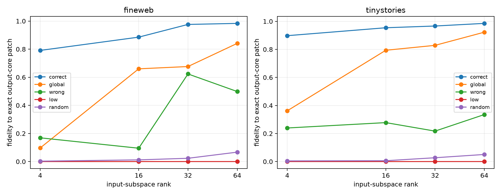

# Input-side forms of Layer-3 family operator banks

For each leave-one-pair-out family bank, its top four weight-defined output axes contract the selected bilinear channels into four symmetric input forms. The rotation-invariant input metric is `sum_j A_j^2`. Its leading eigenspace is compared with correct-family, global, strongest wrong-family, sign-null, and Down/form-pairing controls. Held-out state changes are then projected into top, low, global, wrong, and random input subspaces before recomputing the exact family bank and the full model suffix.

## Locked hypotheses

- **I1_family_input_metric_is_concentrated: supported.**
- **I2_family_input_eigenspace_is_specific: supported.**
- **I3_input_concentration_exceeds_coordination_nulls: not supported.**
- **I4_top32_input_modes_causally_recover_core: supported.**
- **I5_top32_input_modes_beat_random: supported.**
- **I6_top32_input_modes_are_family_specific: supported.**
- **I7_top64_input_modes_nearly_recover_core: supported.**
- **I8_input_mode_effect_transfers_ood: supported.**

Median top-32 input energy: **0.656**; sign-null **0.635**; pairing-null **0.500**.

| Corpus | Input basis | Rank | Core-patch fidelity | Full-MLP fidelity |
|---|---|---:|---:|---:|
| fineweb | correct | 4 | 0.791 | 0.058 |
| fineweb | correct | 16 | 0.886 | 0.159 |
| fineweb | correct | 32 | 0.976 | 0.213 |
| fineweb | correct | 64 | 0.984 | 0.217 |
| fineweb | global | 4 | 0.097 | -0.000 |
| fineweb | global | 16 | 0.660 | 0.045 |
| fineweb | global | 32 | 0.676 | 0.086 |
| fineweb | global | 64 | 0.841 | 0.199 |
| fineweb | wrong | 4 | 0.169 | 0.002 |
| fineweb | wrong | 16 | 0.095 | 0.005 |
| fineweb | wrong | 32 | 0.624 | 0.007 |
| fineweb | wrong | 64 | 0.498 | 0.011 |
| fineweb | low | 4 | 0.000 | 0.000 |
| fineweb | low | 16 | 0.000 | 0.000 |
| fineweb | low | 32 | 0.000 | -0.000 |
| fineweb | low | 64 | 0.000 | -0.000 |
| fineweb | random | 4 | 0.003 | -0.000 |
| fineweb | random | 16 | 0.012 | 0.002 |
| fineweb | random | 32 | 0.023 | 0.002 |
| fineweb | random | 64 | 0.067 | 0.008 |
| fineweb | exact output core | — | 1.000 | 0.231 |
| fineweb | exact full bank | — | -0.302 | 0.378 |

Correct/global/best-wrong rank-32 input overlap: **0.734 / 0.269 / 0.408**.

| tinystories | correct | 4 | 0.898 | 0.075 |
| tinystories | correct | 16 | 0.954 | 0.118 |
| tinystories | correct | 32 | 0.967 | 0.159 |
| tinystories | correct | 64 | 0.986 | 0.153 |
| tinystories | global | 4 | 0.362 | 0.002 |
| tinystories | global | 16 | 0.794 | 0.040 |
| tinystories | global | 32 | 0.829 | 0.075 |
| tinystories | global | 64 | 0.923 | 0.116 |
| tinystories | wrong | 4 | 0.239 | 0.003 |
| tinystories | wrong | 16 | 0.278 | 0.014 |
| tinystories | wrong | 32 | 0.217 | 0.019 |
| tinystories | wrong | 64 | 0.335 | 0.033 |
| tinystories | low | 4 | -0.000 | -0.000 |
| tinystories | low | 16 | -0.000 | -0.000 |
| tinystories | low | 32 | -0.000 | -0.000 |
| tinystories | low | 64 | 0.000 | -0.000 |
| tinystories | random | 4 | 0.005 | 0.000 |
| tinystories | random | 16 | 0.006 | 0.002 |
| tinystories | random | 32 | 0.027 | 0.002 |
| tinystories | random | 64 | 0.051 | 0.006 |
| tinystories | exact output core | — | 1.000 | 0.165 |
| tinystories | exact full bank | — | -0.056 | 0.295 |

Correct/global/best-wrong rank-32 input overlap: **0.734 / 0.269 / 0.408**.

A concentrated, recurring metric is a weight-level description of which residual directions the bank can discriminate. Causal projection is the stronger test: it asks whether the actual held-out semantic state change travels through those directions. A failure there means the global form energy and the naturally used edit path are different explanatory objects.
