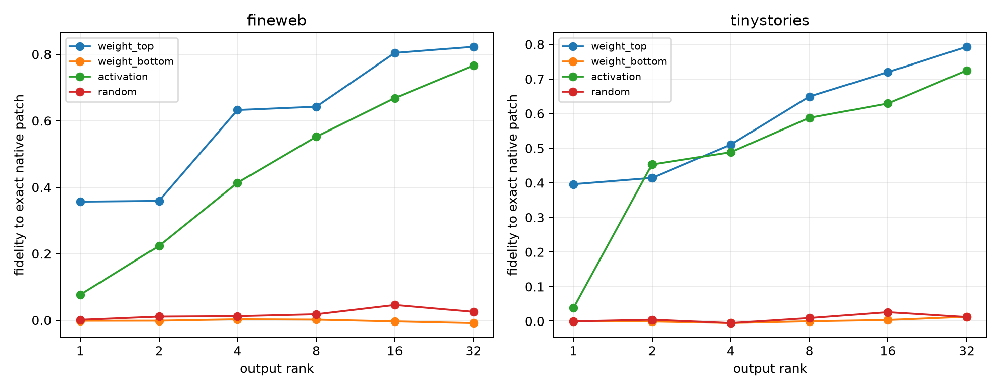

# Output compression of reusable Layer-3 native channel banks

For each lexical query, the leave-one-pair-out family channel bank is frozen. Its current native write is projected onto four nested output bases: top and bottom left singular vectors of the bank's Down columns, an activation-weighted basis learned from the other family pairs, and a fixed random basis. Every patch is evaluated through layers 4--17.

## Locked hypotheses

- **B1_weight_rank32_compresses_native_bank: supported.**
- **B2_activation_rank32_nearly_recovers_native_bank: not supported.**
- **B3_activation_rank16_beats_weight_rank16: not supported.**
- **B4_activation_rank32_preserves_full_mlp_relevance: not supported.**
- **B5_weight_top32_is_specific: supported.**
- **B6_activation_code_transfers_ood: supported.**

| Corpus | Basis | Rank | Native-patch fidelity | Full-MLP fidelity | Local native-write fidelity |
|---|---|---:|---:|---:|---:|
| fineweb | weight_top | 1 | 0.357 | 0.068 | 0.165 |
| fineweb | weight_top | 2 | 0.359 | 0.065 | 0.177 |
| fineweb | weight_top | 4 | 0.632 | 0.231 | 0.285 |
| fineweb | weight_top | 8 | 0.642 | 0.217 | 0.446 |
| fineweb | weight_top | 16 | 0.804 | 0.227 | 0.507 |
| fineweb | weight_top | 32 | 0.823 | 0.231 | 0.609 |
| fineweb | weight_bottom | 1 | -0.002 | -0.001 | 0.001 |
| fineweb | weight_bottom | 2 | -0.002 | -0.003 | 0.001 |
| fineweb | weight_bottom | 4 | 0.003 | 0.001 | 0.003 |
| fineweb | weight_bottom | 8 | 0.002 | -0.004 | 0.007 |
| fineweb | weight_bottom | 16 | -0.004 | -0.002 | 0.012 |
| fineweb | weight_bottom | 32 | -0.009 | -0.005 | 0.023 |
| fineweb | activation | 1 | 0.077 | 0.011 | 0.030 |
| fineweb | activation | 2 | 0.223 | 0.057 | 0.192 |
| fineweb | activation | 4 | 0.413 | 0.106 | 0.250 |
| fineweb | activation | 8 | 0.552 | 0.105 | 0.312 |
| fineweb | activation | 16 | 0.668 | 0.159 | 0.442 |
| fineweb | activation | 32 | 0.766 | 0.229 | 0.521 |
| fineweb | random | 1 | 0.001 | 0.001 | 0.001 |
| fineweb | random | 2 | 0.011 | 0.002 | 0.001 |
| fineweb | random | 4 | 0.012 | -0.001 | 0.004 |
| fineweb | random | 8 | 0.018 | 0.005 | 0.007 |
| fineweb | random | 16 | 0.046 | 0.012 | 0.014 |
| fineweb | random | 32 | 0.025 | 0.013 | 0.027 |
| fineweb | exact native | 256 channels | 1.000 | 0.378 | 1.000 |
| tinystories | weight_top | 1 | 0.396 | 0.167 | 0.241 |
| tinystories | weight_top | 2 | 0.414 | 0.131 | 0.290 |
| tinystories | weight_top | 4 | 0.510 | 0.164 | 0.303 |
| tinystories | weight_top | 8 | 0.649 | 0.157 | 0.450 |
| tinystories | weight_top | 16 | 0.720 | 0.197 | 0.526 |
| tinystories | weight_top | 32 | 0.793 | 0.241 | 0.647 |
| tinystories | weight_bottom | 1 | -0.000 | -0.000 | 0.000 |
| tinystories | weight_bottom | 2 | -0.001 | -0.000 | 0.001 |
| tinystories | weight_bottom | 4 | -0.005 | -0.002 | 0.002 |
| tinystories | weight_bottom | 8 | -0.000 | 0.000 | 0.004 |
| tinystories | weight_bottom | 16 | 0.003 | -0.001 | 0.011 |
| tinystories | weight_bottom | 32 | 0.013 | 0.008 | 0.019 |
| tinystories | activation | 1 | 0.038 | 0.017 | 0.063 |
| tinystories | activation | 2 | 0.453 | 0.138 | 0.259 |
| tinystories | activation | 4 | 0.488 | 0.140 | 0.293 |
| tinystories | activation | 8 | 0.588 | 0.211 | 0.397 |
| tinystories | activation | 16 | 0.629 | 0.190 | 0.501 |
| tinystories | activation | 32 | 0.725 | 0.236 | 0.595 |
| tinystories | random | 1 | -0.001 | -0.000 | 0.001 |
| tinystories | random | 2 | 0.004 | 0.001 | 0.002 |
| tinystories | random | 4 | -0.005 | 0.000 | 0.003 |
| tinystories | random | 8 | 0.009 | 0.003 | 0.007 |
| tinystories | random | 16 | 0.026 | 0.004 | 0.013 |
| tinystories | random | 32 | 0.012 | 0.005 | 0.029 |
| tinystories | exact native | 256 channels | 1.000 | 0.295 | 1.000 |

A compact activation-weighted basis would show that the stable native address bank writes through a reusable low-dimensional output code even though the broader family output PCA failed. A broad result instead means that reuse resides in channel identity and input-side bilinear conditions, not in a short downstream write vocabulary.
