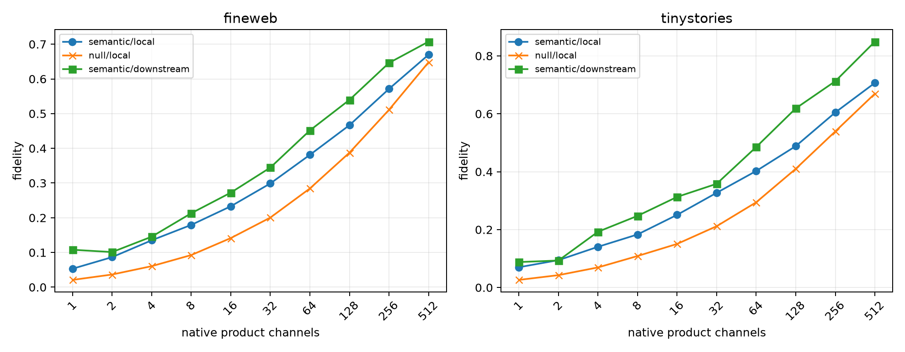

# Native-channel circuits in the Layer-3 bilinear MLP

For each semantic and cross-family-null token replacement, the exact Layer-3 product delta is decomposed into native channel writes `Down[:,c] Δh_c`. Channels are ranked by signed projection onto the complete MLP write delta. Nested channel sets are inserted into the base run, after which blocks 4–17 and the unembedding are recomputed. Channel-set recurrence is measured against disjoint FineWeb contexts.

## Locked hypotheses

- **C1_native_channel_decomposition_is_exact: supported.**
- **C2_top64_is_locally_sufficient: not supported.**
- **C3_top256_is_near_locally_sufficient: not supported.**
- **C4_top256_is_downstream_sufficient_for_mlp3: supported.**
- **C5_native_channels_recur_by_lexical_pair: supported.**
- **C6_native_channels_recur_by_semantic_family: supported.**
- **C7_semantic_edits_are_more_channel_concentrated: not supported.**
- **C8_semantic_and_null_channel_sets_differ: supported.**

| Corpus | Condition | Top64 local fidelity | Top256 local fidelity | Top256 downstream fidelity | Full MLP target projection |
|---|---|---:|---:|---:|---:|
| fineweb | semantic | 0.381 | 0.571 | 0.646 | 0.264 |
| fineweb | cross-family null | 0.284 | 0.511 | 0.509 | 0.352 |
| tinystories | semantic | 0.402 | 0.605 | 0.713 | 0.362 |
| tinystories | cross-family null | 0.294 | 0.539 | 0.585 | 0.414 |

| Query corpus | Same-pair Jaccard | Same-family / different-family | Family gap | Semantic/null same-context Jaccard |
|---|---:|---:|---:|---:|
| fineweb | 0.113 | 0.058 / 0.008 | 0.050 | 0.094 |
| tinystories | 0.123 | 0.058 / 0.008 | 0.050 | 0.085 |

Maximum all-channel recomposition error: `2.00e-06`.

A recurring channel set is evidence for stable native routing of a declared edit family, not automatically a monosemantic neuron. A channel can recur because it implements a reusable algebraic discrimination while its activation conditions remain heterogeneous. Conversely, low set recurrence can coexist with a stable non-native interaction subspace.
