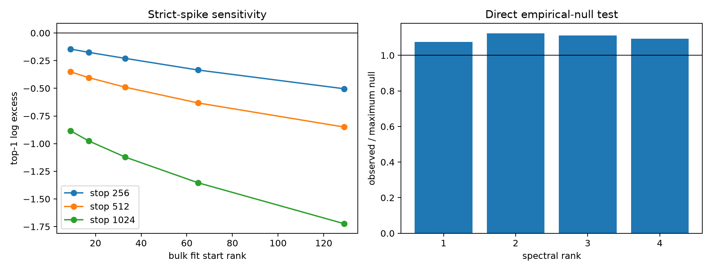

# Layer-3 power-law and spike sensitivity red team

The frozen spectrum is re-fit over fifteen bulk windows. Spike strength is also compared directly with all 32 coordination-null spectra, avoiding bulk extrapolation. Finally, power-law and exponential-rank models are fit on alternating ranks and scored on held-out ranks 33--1024.

## Locked hypotheses

- **R1_no_strict_spike_is_window_robust: supported.**
- **R2_relative_null_advantage_is_window_robust: not supported.**
- **R3_top_singular_value_is_empirical_null_outlier: supported.**
- **R4_all_top4_are_empirical_null_outliers: supported.**
- **R5_powerlaw_predicts_tail_better_than_exponential: not supported.**
- **R6_top4_energy_exceeds_every_null: supported.**

No-strict-spike fraction across windows: **100.0%**.
Observed relative-bulk top four beat every null in **60.0%** of windows.

| Rank | Observed / maximum null singular value |
|---:|---:|
| 1 | 1.0749 |
| 2 | 1.1231 |
| 3 | 1.1124 |
| 4 | 1.0934 |

Observed/null-maximum top-four energy: **0.0208 / 0.0178**.
Held-out log-spectrum RMSE is **0.0890** for a power law versus **0.0223** for an exponential-rank curve (-299.6% relative improvement).

A robust absence of positive extrapolation spikes together with direct null exceedance would mean the observed top spectrum is coordinated but remains part of a continuous heavy tail. Failure of both tests would make the apparent advantage at the original fit window a fitting artifact.
