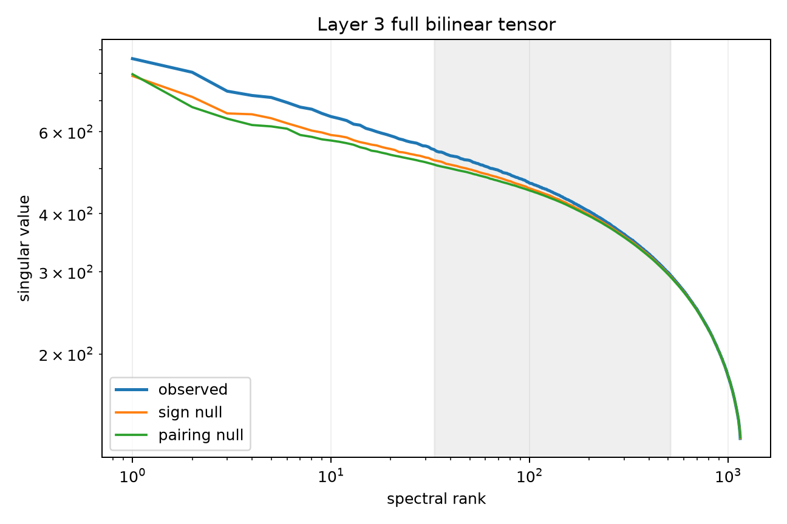

# Layer-3 full-tensor power law and spike audit

The complete Layer-3 bilinear MLP tensor is treated as a symmetric-interaction-to-residual-write operator. Its output-side singular spectrum is computed exactly. Sign nulls preserve channel forms and Down magnitudes but disrupt signed coordination; pairing nulls reassign Down columns to interaction forms.

## Locked hypotheses

- **S1_layer3_has_powerlaw_like_bulk: supported.**
- **S2_coordination_nulls_retain_bulk: supported.**
- **S3_layer3_has_leading_strict_spike: not supported.**
- **S4_layer3_has_four_strict_spikes: not supported.**
- **S5_spikes_exceed_all_coordination_nulls: supported.**
- **S6_top4_are_globally_concentrated: not supported.**

| Spectrum | Alpha / R² | Top-1 excess | Mean top-4 excess | Top-4 energy |
|---|---:|---:|---:|---:|
| observed | 0.241 / 0.968 | -0.490 | -0.401 | 0.021 |
| sign-null median | 0.226 / 0.960 | — | -0.416 | 0.018 |
| pairing-null median | 0.219 / 0.955 | — | -0.410 | 0.017 |

Individual observed top-four log excesses: -0.490, -0.390, -0.386, -0.337.

A positive extrapolation excess is a strict spike under this frozen bulk fit, not circuit validation. If the native family-address result coexists with no strict spike, reusable computations are embedded in the tensor bulk. If spikes exist, they become prospectively selected candidates for semantic and causal validation.
