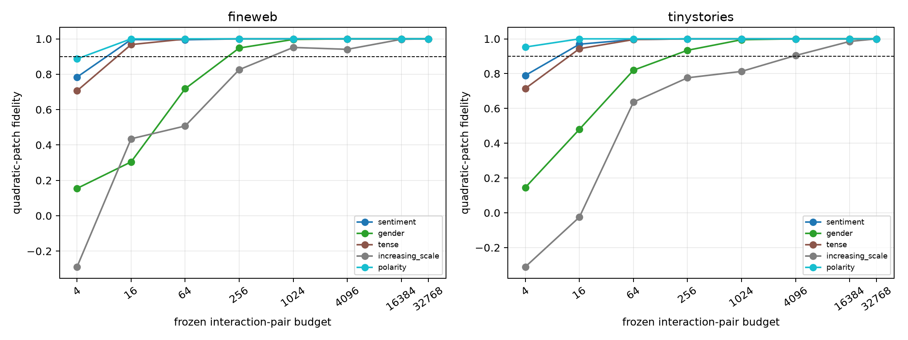

# Sparsity of signed quadratic interaction webs in Layer 3

Inside each family-specific causal input basis, the four output forms become a small signed tensor `C[o,i,j]`. Symmetric coordinate pairs are ranked once using their squared contribution on the leave-one-pair-out discovery edits, then frozen for held-out FineWeb and TinyStories. Coefficient-only and random rankings, plus complete diagonal and off-diagonal terms, are controls.

## Locked hypotheses

- **M1_quadratic_tensor_is_offdiagonal: not supported.**
- **M2_offdiagonal_terms_are_causally_substantial: not supported.**
- **M3_frozen_top64_pairs_are_useful: supported.**
- **M4_frozen_top256_pairs_are_sufficient: supported.**
- **M5_activation_ranking_beats_weight_ranking: not supported.**
- **M6_activation_ranking_beats_random: supported.**
- **M7_every_family_has_pair_k90_by4096: supported.**
- **M8_pair_k90_is_ood_stable: supported.**

| Corpus | Family | Input rank / pair count | Off-diagonal weight energy | Diagonal / off-diagonal fidelity | Pair K90 | Activation curve (4→32768) |
|---|---|---:|---:|---:|---:|---|
| fineweb | sentiment | 32 / 528 | 0.388 | 0.681 / -0.726 | 16 | 0.784, 0.996, 0.995, 1.000, 1.000, 1.000, 1.000, 1.000 |
| fineweb | gender | 64 / 2080 | 0.524 | 0.387 / 0.879 | 256 | 0.154, 0.304, 0.718, 0.948, 0.997, 1.000, 1.000, 1.000 |
| fineweb | tense | 16 / 136 | 0.338 | 0.332 / -0.038 | 16 | 0.706, 0.968, 0.999, 1.000, 1.000, 1.000, 1.000, 1.000 |
| fineweb | increasing_scale | 256 / 32896 | 0.463 | 0.634 / 0.576 | 1024 | -0.289, 0.435, 0.507, 0.826, 0.951, 0.941, 0.997, 1.000 |
| fineweb | polarity | 4 / 10 | 0.311 | -0.482 / 0.112 | 16 | 0.887, 1.000, 1.000, 1.000, 1.000, 1.000, 1.000, 1.000 |
| tinystories | sentiment | 32 / 528 | 0.388 | 0.317 / -1.587 | 16 | 0.790, 0.969, 0.996, 1.000, 1.000, 1.000, 1.000, 1.000 |
| tinystories | gender | 64 / 2080 | 0.524 | 0.353 / 0.626 | 256 | 0.146, 0.480, 0.820, 0.934, 0.995, 1.000, 1.000, 1.000 |
| tinystories | tense | 16 / 136 | 0.338 | 0.508 / -0.027 | 16 | 0.715, 0.943, 0.996, 1.000, 1.000, 1.000, 1.000, 1.000 |
| tinystories | increasing_scale | 256 / 32896 | 0.463 | 0.571 / 0.552 | 4096 | -0.311, -0.025, 0.636, 0.776, 0.813, 0.904, 0.985, 1.000 |
| tinystories | polarity | 4 / 10 | 0.311 | -0.062 / -1.632 | 4 | 0.953, 1.000, 1.000, 1.000, 1.000, 1.000, 1.000, 1.000 |

A low pair K90 supports a sparse verb-like interaction program in the chosen causal basis. A high K90 or strong diagonal control instead indicates a broad code or mostly independent feature-strength computation. Because the basis and output core are declared first, this measures sparsity within a specific explanatory quotient rather than claiming a unique global tensor decomposition.
