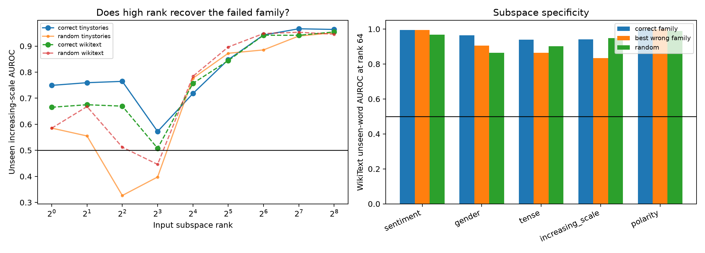

# Rank of semantic information in Layer-3 family input subspaces

For each weight-defined family input eigenspace, a rotation-invariant linear mean-contrast probe is fit on only the original seed-token occurrences in FineWeb. Nested ranks are then evaluated on the previously frozen unseen lexicons in TinyStories and WikiText-103. Other family eigenspaces and an isotropic random subspace are controls. AUROC uses every positive and a fixed 20,000-negative sample per locked key.

## Locked hypotheses

- **R1_scale_exists_in_high_rank_family_subspace: supported.**
- **R2_scale_subspace_beats_random: not supported.**
- **R3_scale_subspace_is_family_specific: not supported.**
- **R4_correct_family_subspaces_beat_random: not supported.**
- **R5_correct_family_subspaces_are_specific: supported.**
- **R6_scale_context_persists_in_high_rank_code: not supported.**
- **R7_semantic_rank_is_compact: supported.**
- **R8_high_rank_random_projection_does_not_close_gap: supported.**

| Target family | K80 Tiny/Wiki | Tiny correct 64/256 | Tiny wrong/random 256 | Wiki correct 64/256 | Wiki wrong/random 256 | +1 Tiny/Wiki 256 |
|---|---:|---:|---:|---:|---:|---:|
| sentiment | 1/1 | 0.996/0.996 | 0.996/0.991 | 0.995/0.995 | 0.996/0.981 | 0.757/0.769 |
| gender | 4/4 | 0.938/0.932 | 0.928/0.885 | 0.965/0.953 | 0.965/0.904 | 0.392/0.488 |
| tense | 2/2 | 0.898/0.924 | 0.922/0.923 | 0.940/0.943 | 0.949/0.949 | 0.532/0.682 |
| increasing_scale | 32/32 | 0.943/0.964 | 0.959/0.951 | 0.942/0.954 | 0.947/0.946 | 0.461/0.599 |
| polarity | 1/1 | 0.998/0.997 | 0.997/0.994 | 0.999/0.999 | 0.999/0.997 | 0.924/0.913 |

A successful correct-family curve would show that a failed leading axis hid a distributed semantic code. Matching wrong-family or random curves instead means high-rank linear decodability is generic residual-stream information, not evidence that the selected family tensor module owns that concept. This distinction is essential because sufficiently wide random projections preserve many lexical distinctions.
