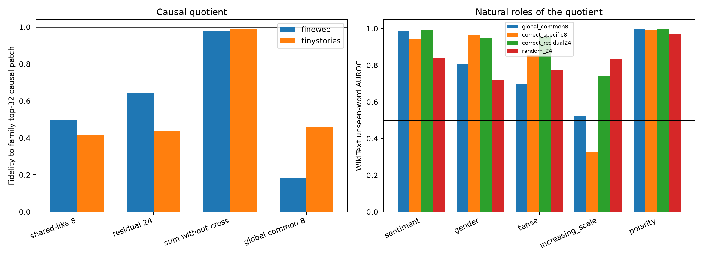

# Shared lexical-backbone quotient of Layer-3 family input spaces

The top-eight eigenspace of the mean of five weight-defined family projectors is the global common candidate. Each family top-32 space is then rotated internally and split orthogonally into the eight coordinates most aligned with that common space and a residual 24. Their union is exactly the original family space. Finite counterfactuals test each part, their missing bilinear cross term, wrong-family residuals, and a global common basis. Natural probes are trained only on original FineWeb seed tokens and evaluated on frozen unseen lexicons.

## Locked hypotheses

- **B1_common_weight_subspace_exists: supported.**
- **B2_family_split_preserves_the_original_space: supported.**
- **B3_residual_spaces_are_more_family_specific: not supported.**
- **C1_union_reproduces_the_causal_family_patch: supported.**
- **C2_shared_coordinates_are_causally_substantial: supported.**
- **C3_residual_coordinates_are_causally_substantial: not supported.**
- **C4_shared_residual_cross_term_is_nontrivial: supported.**
- **C5_residual_causality_is_family_specific: supported.**
- **C6_global_common_basis_is_not_sufficient: supported.**
- **S1_common_space_contains_shared_lexical_roles: supported.**
- **S2_specific_coordinates_recover_gender_and_tense: supported.**
- **S3_scale_residual_is_not_generic_decodability: not supported.**
- **S4_shared_roles_persist_after_the_token: supported.**

## Weight geometry

Median original-family overlap: **0.074**; residual-family overlap: **0.043**.

| Family | Common overlap | Split projector error |
|---|---:|---:|
| sentiment | 0.928 | 4.86e-07 |
| gender | 0.069 | 5.56e-07 |
| tense | 0.147 | 5.63e-07 |
| increasing_scale | 0.921 | 5.40e-07 |
| polarity | 0.899 | 5.32e-07 |

## Finite causal decomposition

| Corpus | Shared-like 8 | Residual 24 | Sum without cross | Cross norm share | Global common 8 | Best wrong residual |
|---|---:|---:|---:|---:|---:|---:|
| fineweb | 0.498 | 0.644 | 0.976 | 0.143 | 0.184 | 0.090 |
| tinystories | 0.415 | 0.440 | 0.991 | 0.154 | 0.461 | 0.066 |

## Unseen-word roles

| Family | Tiny common/specific/residual/random | Wiki common/specific/residual/random | Common +1 Tiny/Wiki |
|---|---:|---:|---:|
| sentiment | 0.991/0.982/0.993/0.720 | 0.988/0.944/0.990/0.842 | 0.759/0.650 |
| gender | 0.750/0.910/0.905/0.665 | 0.809/0.964/0.949/0.721 | 0.372/0.525 |
| tense | 0.416/0.876/0.928/0.844 | 0.695/0.856/0.956/0.773 | 0.388/0.597 |
| increasing_scale | 0.538/0.251/0.817/0.736 | 0.525/0.326/0.738/0.833 | 0.475/0.508 |
| polarity | 0.997/0.994/0.997/0.986 | 0.997/0.993/0.999/0.971 | 0.934/0.902 |

This quotient has three distinct possible successes: shared geometry, semantic decoding, and causal sufficiency. They are reported separately. A common lexical probe does not prove that the common directions carry a family edit; a causal residual does not prove that its natural activation has a clean human label; and a cross term means neither orthogonal state component is independently sufficient in a bilinear layer.
