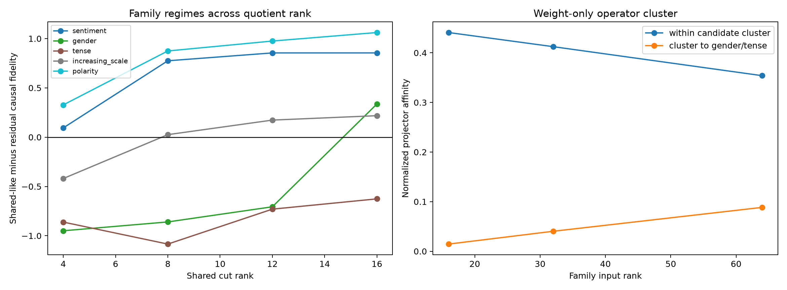

# Rank and cluster red-team for the Layer-3 shared quotient

The shared cut is swept from 4 to 16 dimensions while preserving each family's exact top-32 union. Separately, projector affinity is recomputed at family ranks 16, 32, and 64. The candidate sentiment/increasing-scale/polarity cluster was frozen after the first quotient geometry and is tested against gender and tense before this causal sweep.

## Locked hypotheses

- **R1_rank8_is_not_a_unique_spectral_cut: supported.**
- **R2_candidate_cluster_is_weight_stable: supported.**
- **R3_sentiment_and_polarity_are_shared_dominant: supported.**
- **R4_gender_and_tense_are_residual_dominant: not supported.**
- **R5_scale_is_a_mixed_regime: supported.**
- **R6_cross_term_survives_rank_choice: supported.**
- **R7_global_mean_basis_is_never_sufficient: supported.**
- **R8_family_regime_transfers_ood: not supported.**

The rank-8/rank-9 mean-projector eigenvalue ratio is **1.042**.

| Family rank | Within-cluster affinity | Cluster-to-outside affinity | Gap |
|---:|---:|---:|---:|
| 16 | 0.441 | 0.014 | 0.426 |
| 32 | 0.412 | 0.040 | 0.372 |
| 64 | 0.354 | 0.088 | 0.265 |

| Corpus / family | shared−residual @ 4 | shared−residual @ 8 | shared−residual @ 12 | shared−residual @ 16 |
|---|---:|---:|---:|---:|
| fineweb / sentiment | 0.257 | 0.881 | 0.805 | 0.844 |
| fineweb / gender | -0.934 | -0.952 | -0.628 | 0.027 |
| fineweb / tense | -0.922 | -0.618 | -0.435 | -0.419 |
| fineweb / increasing_scale | -0.597 | -0.390 | -0.172 | 0.089 |
| fineweb / polarity | 0.539 | 0.794 | 0.912 | 0.998 |
| tinystories / sentiment | 0.094 | 0.775 | 0.855 | 0.855 |
| tinystories / gender | -0.949 | -0.860 | -0.706 | 0.337 |
| tinystories / tense | -0.861 | -1.084 | -0.730 | -0.626 |
| tinystories / increasing_scale | -0.419 | 0.026 | 0.173 | 0.218 |
| tinystories / polarity | 0.327 | 0.874 | 0.975 | 1.062 |

A stable sign is a regime label, not a claim that either part is independently sufficient. The layer remains bilinear, and the separately reported cross term measures the interaction lost when shared-like and residual effects are merely added.
