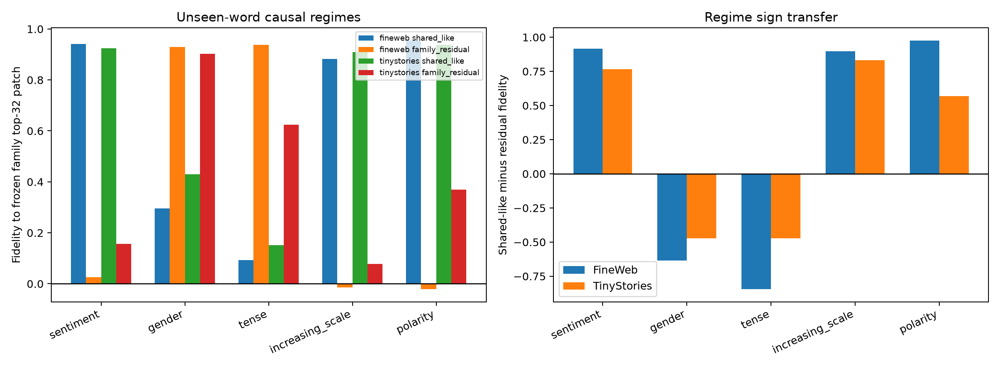

# Unseen-word causal validation of the Layer-3 quotient

Ten manually frozen source/target word pairs per family are disjoint from every seed pair used to construct the channel banks and input metrics. Natural occurrences are placed at the same edit and causal positions as the original test, the target token is substituted, and the model suffix is recomputed. The rank-eight shared/residual quotient is never refit.

## Locked hypotheses

- **U1_unseen_causal_panel_has_coverage: not supported.**
- **U2_sentiment_and_polarity_remain_shared_dominant: not supported.**
- **U3_gender_and_tense_remain_residual_dominant: not supported.**
- **U4_scale_remains_a_mixed_causal_regime: not supported.**
- **U5_unseen_residuals_are_family_specific: not supported.**
- **U6_seed_and_unseen_regime_labels_agree: not supported.**
- **U7_unseen_cross_term_is_nontrivial: not supported.**
- **U8_unseen_regimes_transfer_ood: not supported.**

| Corpus / family | N | Unique source tokens | Shared-like | Residual | Shared−residual | Best wrong residual | Cross norm | Semantic projection |
|---|---:|---:|---:|---:|---:|---:|---:|---:|
| fineweb / sentiment | 10 | 10 | 0.942 | 0.025 | 0.916 | 0.105 | 0.200 | 0.036 |
| fineweb / gender | 10 | 10 | 0.296 | 0.930 | -0.634 | 0.136 | 0.217 | -0.000 |
| fineweb / tense | 10 | 10 | 0.093 | 0.939 | -0.846 | 0.098 | 0.269 | 0.022 |
| fineweb / increasing_scale | 10 | 10 | 0.882 | -0.015 | 0.896 | 0.102 | 0.098 | 0.006 |
| fineweb / polarity | 10 | 10 | 0.955 | -0.022 | 0.977 | 0.121 | 0.206 | 0.040 |
| tinystories / sentiment | 7 | 7 | 0.924 | 0.157 | 0.767 | 0.082 | 0.099 | 0.018 |
| tinystories / gender | 5 | 5 | 0.430 | 0.902 | -0.472 | 0.215 | 0.207 | 0.018 |
| tinystories / tense | 7 | 7 | 0.152 | 0.624 | -0.472 | 0.189 | 0.329 | 0.002 |
| tinystories / increasing_scale | 6 | 6 | 0.909 | 0.078 | 0.832 | 0.104 | 0.062 | 0.009 |
| tinystories / polarity | 1 | 1 | 0.938 | 0.369 | 0.568 | 0.335 | 0.252 | 0.066 |

Fidelity is relative to the frozen family's own top-32 causal patch, not to the entire MLP. This asks whether the internal regime transfers to new lexical realizations. Semantic projection is reported separately because an internally faithful family patch can still be a small or opposing contributor to the complete final-logit counterfactual.

Repeated contexts for the same source token improve context coverage but do not improve lexical coverage. Any sensitivity run with few unique source tokens must therefore be read as a context-robustness test, not as independent evidence for family-wide lexical generalization.
