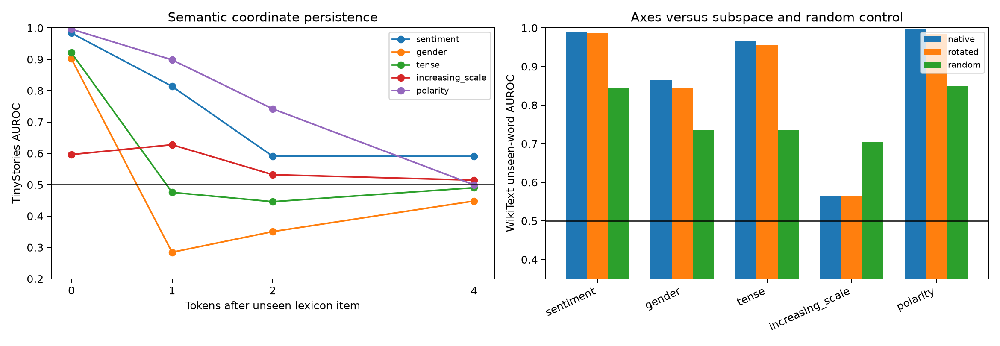

# Unseen-word and context-persistence test for Layer-3 modes

The native, rotated-subspace, and isotropic-random representative axes, including their signal type, sign, and source/target pole, are frozen from the exact-seed-token experiment. This follow-up evaluates disjoint, manually declared one-token lexicons and adds WikiText-103 as a third corpus. Offset tests ask whether the coordinate remains informative after the lexical token is no longer the current repeatedly injected embedding.

## Locked hypotheses

- **U1_unseen_words_transfer: supported.**
- **U2_native_modes_beat_random_on_unseen_words: supported.**
- **U3_native_axes_beat_rotated_subspace: not supported.**
- **U4_semantics_persist_one_token: supported.**
- **U5_contextual_state_beats_current_embedding_after_token: supported.**
- **U6_unseen_family_labels_are_specific: supported.**
- **U7_current_token_abstraction_exceeds_embedding: not supported.**
- **U8_increasing_scale_generalizes: not supported.**
- **U9_unseen_transfer_is_corpus_stable: supported.**

| Family/pole | Fine current | Tiny current / +1 | Wiki current / +1 | Tiny embed | Wiki embed | Tiny wrong | Wiki wrong | Wiki rotated/random |
|---|---:|---:|---:|---:|---:|---:|---:|---:|
| sentiment / target | 0.971 | 0.984 / 0.814 | 0.989 / 0.690 | 0.995 | 0.994 | 0.916 | 0.923 | 0.987 / 0.843 |
| gender / source | 0.898 | 0.902 / 0.284 | 0.864 / 0.249 | 0.964 | 0.989 | 0.751 | 0.647 | 0.844 / 0.736 |
| tense / target | 0.949 | 0.921 / 0.476 | 0.965 / 0.720 | 0.897 | 0.907 | 0.598 | 0.643 | 0.956 / 0.736 |
| increasing_scale / target | 0.529 | 0.596 / 0.627 | 0.566 / 0.600 | 0.823 | 0.731 | 0.994 | 0.989 | 0.563 / 0.705 |
| polarity / target | 0.990 | 0.996 / 0.898 | 0.995 / 0.838 | 0.999 | 0.999 | 0.801 | 0.888 | 0.985 / 0.850 |

Offset-zero success beyond the direct embedding baseline would support a transformed semantic coordinate; equality instead supports inherited lexical geometry. Offset-one success with a weak current-token embedding baseline is stronger evidence of contextual transport. Rotated axes matching native axes means the explanatory object is the family subspace, not its exact weight eigenbasis. Wrong-family AUROC is oriented adversarially and therefore detects shared or multiplexed axes even when the sign differs.
