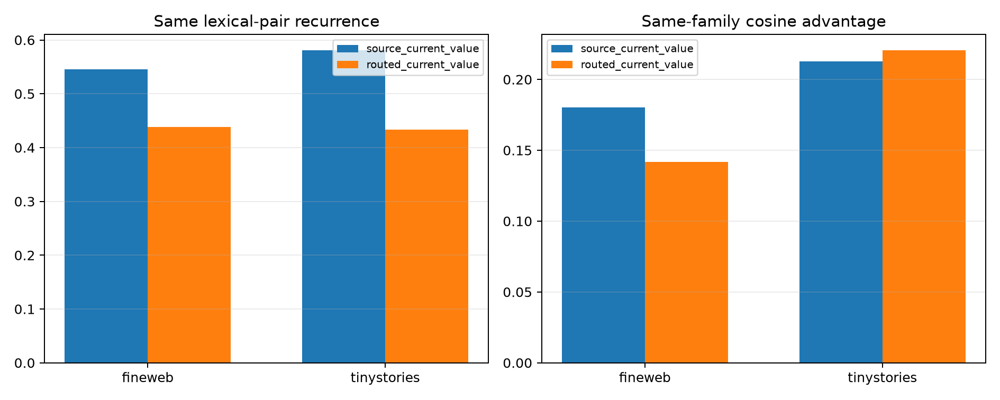

# Recurrence of the Layer-4 current-value code

The dominant current-V path is inspected before and after the frozen 64-edge attention skeleton. The raw code is the changed current-value vector at the edited source. The routed code is the exact current-V Shapley write over the seventeen affected positions. One FineWeb context per lexical pair is the frozen reference; disjoint FineWeb and TinyStories contexts are queried against those references.

## Locked hypotheses

- **V1_source_value_code_is_lexically_recurrent: supported.**
- **V2_routed_value_code_is_lexically_recurrent: supported.**
- **V3_routed_code_identifies_lexical_pair: supported.**
- **V4_source_value_abstracts_semantic_family: supported.**
- **V5_routed_value_abstracts_semantic_family: supported.**
- **V6_routing_improves_semantic_abstraction: not supported.**

| Query corpus | Representation | Same-pair cosine | Same-family / different-family | Family gap | Pair retrieval |
|---|---|---:|---:|---:|---:|
| fineweb | source_current_value | 0.546 | 0.211 / 0.031 | 0.180 | 0.737 |
| fineweb | routed_current_value | 0.438 | 0.159 / 0.017 | 0.142 | 0.632 |
| tinystories | source_current_value | 0.581 | 0.246 / 0.033 | 0.213 | 0.579 |
| tinystories | routed_current_value | 0.434 | 0.236 / 0.015 | 0.221 | 0.579 |

Pair recurrence means that a particular token replacement produces a repeatable transported direction. Family recurrence is the stronger claim that different word pairs in the same hand-labelled category share a direction. Neither establishes that the code is sufficient for the full behavioral change.
