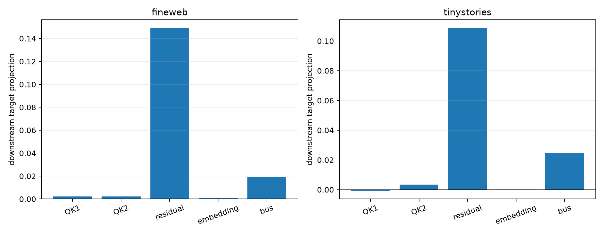

# Repeated embedding versus residual construction of Layer-4 value content

The dominant current-value path is split into the incoming residual state and the stable token embedding injected again at Layer 4. Along with QK1, QK2, and the inherited layer-0 value bus, this defines 32 exact hybrid worlds. RMSNorm and the current value projection are recomputed for every residual/embedding coalition before the layer MLP and full suffix are run.

## Locked hypotheses

- **W1_five_factor_shapley_recomposes_routes: supported.**
- **W2_embedding_injection_dominates: not supported.**
- **W3_residual_state_is_nontrivial: supported.**
- **W4_current_value_construction_dominates: supported.**
- **W5_embedding_and_residual_do_not_cancel: supported.**
- **W6_construction_mix_transfers_ood: supported.**
- **W7_frozen_and_oracle_construction_match: supported.**
- **W8_construction_attribution_is_cross_world_stable: supported.**

| Corpus | Route | Removal route | QK1 / QK2 / residual / embedding / bus projection | Absolute shares | Residual+embedding cancellation |
|---|---|---:|---:|---:|---:|
| fineweb | frozen64 | 0.183 | 0.002 / 0.002 / 0.149 / 0.001 / 0.019 | 0.067 / 0.054 / 0.689 / 0.009 / 0.151 | 1.000 |
| fineweb | oracle64 | 0.294 | -0.005 / -0.003 / 0.217 / 0.001 / 0.022 | 0.058 / 0.106 / 0.644 / 0.006 / 0.107 | 1.000 |
| tinystories | frozen64 | 0.108 | -0.001 / 0.003 / 0.109 / 0.000 / 0.025 | 0.048 / 0.068 / 0.645 / 0.004 / 0.201 | 1.000 |
| tinystories | oracle64 | 0.241 | 0.008 / 0.012 / 0.148 / 0.000 / 0.027 | 0.070 / 0.095 / 0.712 / 0.004 / 0.132 | 1.000 |

| Corpus | Residual / embedding / value-bus coefficients | Insertion→removal | Frozen/oracle cosine |
|---|---:|---:|---:|
| fineweb | 0.463 / 8.000 / -4.188 | 0.840 | 0.999 |
| tinystories | 0.463 / 8.000 / -4.188 | 0.802 | 0.996 |

Maximum vector Shapley recomposition error: `1.16e-07`. Cross-corpus absolute-share L1 distance: `0.132`.

This separates causal input paths under the declared coalition game. It does not by itself say whether the embedding geometry was learned by this model, inherited from tied training dynamics, or semantically sufficient without contextual residual processing.
