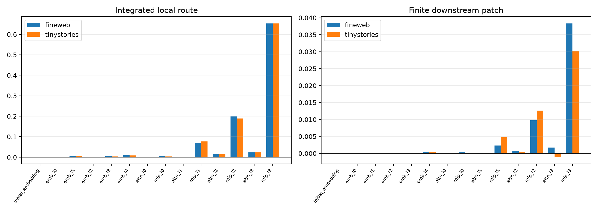

# Exact upstream telescope of the Layer-4 current-value relay

The Layer-4 mixed-state edit is decomposed exactly using `x_(l+1)=a_l x_l+b_l x0+attention_l+MLP_l`. Fourteen additive terms distinguish the initial embedding, repeated embedding injections at layers 0–4, and attention/MLP writes at layers 0–3. A 16-point Gauss–Legendre integral of the analytic RMSNorm Jacobian maps each term through Layer-4 current-V and the frozen attention skeleton. Resulting write components are patched through the Layer-4 MLP and complete suffix.

## Locked hypotheses

- **Z1_residual_telescope_is_exact: supported.**
- **Z2_integrated_current_value_recomposes: supported.**
- **Z3_integrated_route_recomposes: supported.**
- **Z4_learned_writes_beat_embedding_paths: supported.**
- **Z5_four_components_dominate_locally: supported.**
- **Z6_component_profile_transfers_ood: supported.**
- **Z7_later_blocks_dominate_earlier_blocks: supported.**
- **Z8_current_value_route_is_downstream_nontrivial: supported.**

| Corpus | Component | Raw mixed projection | Local routed projection | Individual downstream projection |
|---|---|---:|---:|---:|
| fineweb | initial_embedding | 0.000 | 0.000 | 0.000 |
| fineweb | repeat_embedding_l0 | 0.000 | 0.000 | 0.000 |
| fineweb | repeat_embedding_l1 | 0.003 | 0.005 | 0.000 |
| fineweb | repeat_embedding_l2 | 0.002 | 0.003 | 0.000 |
| fineweb | repeat_embedding_l3 | 0.003 | 0.004 | 0.000 |
| fineweb | repeat_embedding_l4 | 0.006 | 0.010 | 0.000 |
| fineweb | attention_l0 | 0.000 | -0.000 | 0.000 |
| fineweb | mlp_l0 | 0.003 | 0.004 | 0.000 |
| fineweb | attention_l1 | 0.001 | 0.001 | 0.000 |
| fineweb | mlp_l1 | 0.058 | 0.070 | 0.002 |
| fineweb | attention_l2 | 0.022 | 0.015 | 0.001 |
| fineweb | mlp_l2 | 0.187 | 0.199 | 0.010 |
| fineweb | attention_l3 | 0.062 | 0.023 | 0.002 |
| fineweb | mlp_l3 | 0.648 | 0.653 | 0.038 |
| tinystories | initial_embedding | 0.000 | 0.000 | 0.000 |
| tinystories | repeat_embedding_l0 | 0.000 | 0.000 | 0.000 |
| tinystories | repeat_embedding_l1 | 0.003 | 0.004 | 0.000 |
| tinystories | repeat_embedding_l2 | 0.001 | 0.002 | 0.000 |
| tinystories | repeat_embedding_l3 | 0.002 | 0.004 | 0.000 |
| tinystories | repeat_embedding_l4 | 0.005 | 0.008 | 0.000 |
| tinystories | attention_l0 | 0.000 | -0.000 | 0.000 |
| tinystories | mlp_l0 | 0.003 | 0.004 | 0.000 |
| tinystories | attention_l1 | 0.001 | 0.001 | 0.000 |
| tinystories | mlp_l1 | 0.059 | 0.077 | 0.005 |
| tinystories | attention_l2 | 0.021 | 0.015 | 0.000 |
| tinystories | mlp_l2 | 0.179 | 0.189 | 0.013 |
| tinystories | attention_l3 | 0.070 | 0.023 | -0.001 |
| tinystories | mlp_l3 | 0.649 | 0.653 | 0.030 |

| Corpus | Embedding group | Attention group | MLP group | Learned writes | Early / later writes | All current-V route | Top-4 local share |
|---|---:|---:|---:|---:|---:|---:|---:|
| fineweb | 0.001 | 0.002 | 0.058 | 0.065 | 0.003 / 0.063 | 0.065 | 0.960 |
| tinystories | 0.001 | 0.001 | 0.064 | 0.060 | 0.005 / 0.061 | 0.064 | 0.963 |

Maximum residual telescope error: `5.06e-07`; current-V integral error: `1.65e-06`; routed-write integral error: `7.08e-07`. Cross-corpus absolute component-profile cosine: `1.000`.

The telescope is an exact algebraic decomposition of a particular state difference. Integrated-Jacobian terms allocate its nonlinear RMSNorm/current-V transformation along the straight base-to-counterfactual path. Individual finite patches need not add after the Layer-4 MLP and later nonlinear blocks; group patches are reported separately for that reason.
