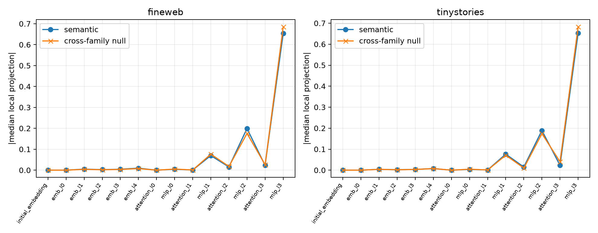

# Cross-family target null for the Layer-4 residual telescope

The semantic source contexts, edit positions, and complete target-token multiset are preserved, but target tokens are deranged so every replacement crosses the original semantic families. The exact residual telescope, integrated current-V attribution, frozen route, and downstream group patches are otherwise unchanged. This asks whether the clean MLP3→MLP2 hierarchy is semantic-specific or a generic token-edit transport program.

## Locked hypotheses

- **Y1_control_decompositions_remain_exact: supported.**
- **Y2_semantic_component_profile_is_specific: not supported.**
- **Y3_semantic_mlp3_share_exceeds_control: not supported.**
- **Y4_semantic_concentration_exceeds_control: not supported.**
- **Y5_semantic_route_is_more_downstream_relevant: not supported.**
- **Y6_semantic_learned_write_advantage_is_larger: not supported.**

| Corpus | Profile cosine | MLP3 share semantic/control | Top-4 semantic/control | All-route downstream semantic/control | Learned/embedding ratio semantic/control |
|---|---:|---:|---:|---:|---:|
| fineweb | 0.999 | 0.662 / 0.682 | 0.960 / 0.961 | 0.065 / 0.050 | 56.7 / 125.6 |
| tinystories | 0.999 | 0.667 / 0.682 | 0.963 / 0.967 | 0.064 / 0.066 | 72.6 / 119.0 |

Target multiset preserved: `True`; every control crosses families: `True`.

A null-like component hierarchy does not erase the earlier semantic recurrence of current-V directions. It means the *location and concentration* of their construction are architectural transport properties; semantic content must be established from the directions carried within those paths, not from the path hierarchy alone.
