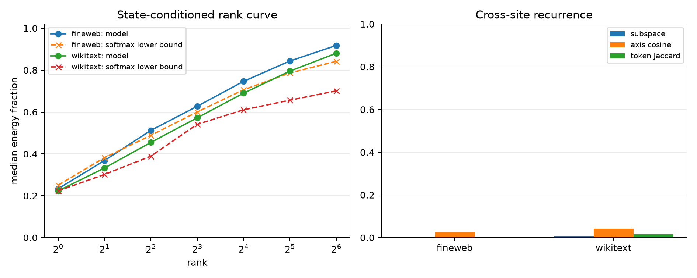

# Basis-invariant Layer-8 behavioral bottleneck

The previous query-conditioned Gram used a complete 512-direction eigenbasis, so readout changes mostly changed coordinates rather than the underlying tangent span. This correction applies unit perturbations in a fixed natural-state basis, propagates the exact bilinear MLP and tensor-attention Jacobian, and eigendecomposes the resulting full-vocabulary Fisher response. Orthogonal basis rotations are checked explicitly.

## Locked hypotheses

- **C1_unit_input_rank16_is_compact: not supported.**
- **C2_unit_input_rank4_is_compact: not supported.**
- **C3_basis_rotation_invariance: supported.**
- **C4_axes_recur_globally: not supported.**
- **C5_prediction_class_explains_recurrence: not supported.**
- **C6_token_labels_recur: not supported.**
- **C7_softmax_geometry_can_support_rank4: supported.**
- **C8_unweighted_logit_axes_recur: not supported.**
- **C9_input_verbs_recur: not supported.**

| Corpus | Rank-4 / rank-16 energy | Pure-softmax rank-4 lower bound | Fisher/logit/input site overlap | Matched-axis cosine | Token Jaccard | Same-class advantage |
|---|---:|---:|---:|---:|---:|---:|
| fineweb | 0.512 / 0.746 | 0.488 | 0.002 / 0.165 / 0.010 | 0.025 | 0.000 | 0.001 |
| wikitext | 0.455 / 0.690 | 0.389 | 0.005 / 0.174 / 0.010 | 0.042 | 0.016 | 0.018 |

The median cross-corpus rank-4 subspace overlap is **0.003**. The worst rotation energy discrepancy is **2.38e-07**, and the worst rotated-basis output-subspace overlap is **0.999999**.

## Concrete decoded axes

### fineweb, row 416

Context: ` the years to include a school for grades one to seven, as well as a general store, post office, library, restaurant`

Native prediction: `,` (0.624); corpus target: `,`.

- Axis 0: promotes ' and', ' dining', ' bar', ' area', ' hall'; suppresses ',', ' with', ' (', '.', '/'.
- Axis 1: promotes ',', ' and', ' with', '.', ' that'; suppresses '/', ' kitchen', ' hall', '-', ' dining'.
- Axis 2: promotes '/', ' (', ' with', '-', ' serving'; suppresses ',', ' and', ' kitchen', ' dining', ' business'.
- Axis 3: promotes ',', '/', ' hall', ' space', ' room'; suppresses ' with', '.', ' serving', '-', ' kitchen'.

### fineweb, row 92

Context: ` a storied history, of over 5,000 years, yoga continues to be popular. This mind, body, and spirit`

Native prediction: ` practice` (0.540); corpus target: `,`.

- Axis 0: promotes ' practice', ' practices', ' practise', ' tradition', ' path'; suppresses ' workout', ' exercise', ' fitness', '-', ' is'.
- Axis 1: promotes ' workout', ' practice', ' exercise', ' fitness', ' yoga'; suppresses ' is', ' has', ' approach', ' of', ' connection'.
- Axis 2: promotes ' workout', ' is', ' practice', ' exercise', ' has'; suppresses ' approach', ' discipline', '-', ' fitness', ' system'.
- Axis 3: promotes '-', ' exercise', ' practice', ' discipline', ' work'; suppresses ' approach', ' system', ' workout', ' style', ' movement'.

### wikitext, row 169

Context: ` to a life in the sea , the only known amphibians to do so with the exception of the modern crab @-@`

Native prediction: ` ,` (0.253); corpus target: ` eating`.

- Axis 0: promotes ' ,', ' .', ' and', '.', ' ('; suppresses ' sn', ' fish', ' ', ' crab', ' the'.
- Axis 1: promotes ' .', ' sn', ' fish', ' ', ' tre'; suppresses ' ,', ' -', ' which', ' the', ' and'.
- Axis 2: promotes ' ,', ' sn', ' fish', ' ', ' crab'; suppresses ' .', ' the', '.', ' which', ' a'.
- Axis 3: promotes ' ,', ' .', ' sn', ' -', ' crab'; suppresses ' and', ' which', '.', ' fish', ','.

### wikitext, row 47

Context: ` the spar torpedo was taken seriously . The U.S. Navy converted four of its monitors to become turretless armored spar @`

Native prediction: ` the` (0.065); corpus target: `-`.

- Axis 0: promotes ' the', ' 1', ' a', ' 50', ' 4'; suppresses 's', 'ms', 'k', 'v', 'f'.
- Axis 1: promotes ' the', ' a', ' The', ' .', ' http'; suppresses ' 1', 'ms', ' 40', ' 50', ' 20'.
- Axis 2: promotes ' the', 'ms', ' a', ' sea', 'rons'; suppresses '1', ' 1', ' $', ' 2', ' 3'.
- Axis 3: promotes ' the', ' .', ' a', ' $', ' that'; suppresses '50', ' Naval', ' sea', ' USS', 'GM'.

## Interpretation

Compactness and semantic recurrence are separate. A low-rank state-conditioned output space can be a short behavioral interface even when its axes rotate with the local next-token alternatives. Stable semantics require recurrence or conditional alignment beyond this rank result.
