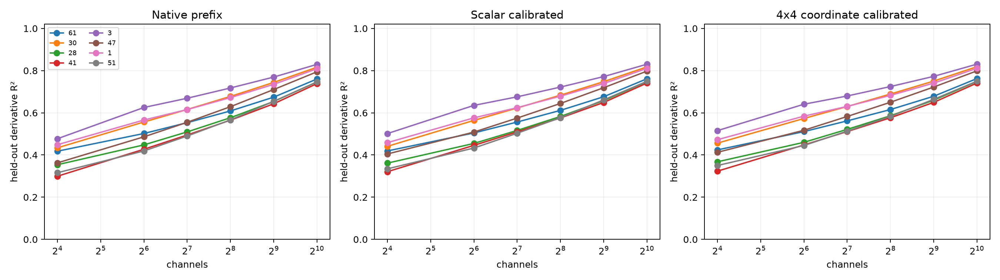

# Calibration red-team for Layer-8 native-channel prefixes

Fixed Shapley-ranked prefixes are evaluated three ways: unchanged native amplitudes; one scalar gain fitted on training contexts; and a 4x4 linear map between the four address coordinates fitted on training contexts. The latter is invariant to choosing a different basis inside the same four-dimensional address, but neither calibrated object is a literal native-channel ablation.

## Locked hypotheses

- **A1_scalar256_is_sufficient: not supported.**
- **A2_coordinate256_is_sufficient: not supported.**
- **A3_scalar_calibration_transfers: not supported.**
- **A4_coordinate_map_adds_value: not supported.**
- **A5_rank256_direction_is_high_fidelity: not supported.**
- **A6_calibrated_description_is_compact: not supported.**

| Address | Scalar/coordinate K90 | R²@256 native / scalar / coordinate | Squared cosine@256 | Scalar@256 | Coordinate off-diagonal |
|---:|---:|---:|---:|---:|---:|
| 61 | None / None | 0.609 / 0.612 / 0.616 | 0.612 | 1.069 | 0.002 |
| 30 | None / None | 0.678 / 0.684 / 0.689 | 0.684 | 1.100 | 0.003 |
| 28 | None / None | 0.577 / 0.583 / 0.586 | 0.583 | 1.107 | 0.002 |
| 41 | None / None | 0.565 / 0.576 / 0.577 | 0.576 | 1.144 | 0.001 |
| 3 | None / None | 0.718 / 0.722 / 0.725 | 0.722 | 1.084 | 0.003 |
| 47 | None / None | 0.629 / 0.644 / 0.650 | 0.644 | 1.176 | 0.003 |
| 1 | None / None | 0.672 / 0.679 / 0.683 | 0.679 | 1.103 | 0.006 |
| 51 | None / None | 0.566 / 0.577 / 0.583 | 0.577 | 1.147 | 0.007 |

Native-prefix sufficiency, directional fidelity, and calibrated surrogate fidelity are separate definitions. A scalar success would mean the long tail mainly supplies gain; a 4x4-only success would mean it also rotates or rescales coordinates inside an otherwise stable address-level operation.
