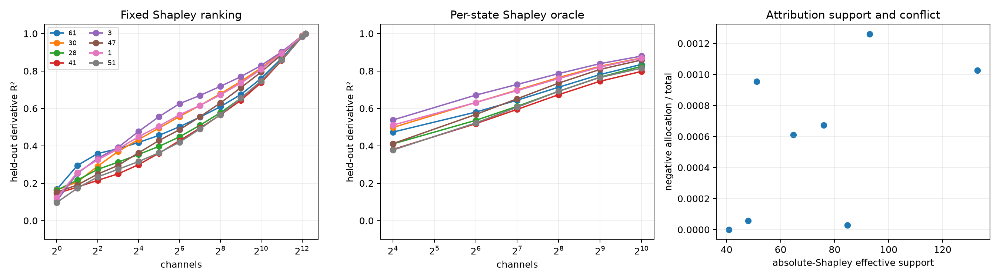

# Cooperative-attribution red-team for Layer-8 native channels

For the exact channel contributions `C_h`, the squared-write cooperative game has value `v(S)=||sum_{h in S} C_h||²`. Its exact Shapley allocation is `<C_h, sum_k C_k>`: self energy plus each pair interaction split equally. These signed allocations sum exactly to total derivative energy. Rankings are learned on training contexts and tested on disjoint contexts; per-state rankings remain oracle diagnostics.

## Locked hypotheses

- **S1_shapley_allocation_is_exact: supported.**
- **S2_shapley_ranking_improves_static: not supported.**
- **S3_static_shapley512_is_sufficient: not supported.**
- **S4_oracle_shapley256_is_sufficient: not supported.**
- **S5_cooperative_ranking_transfers: supported.**
- **S6_shapley_support_is_sparse: supported.**
- **S7_sufficiency_remains_broad: supported.**

| Address | Shapley/energy K90 | Shapley/energy R² @256 | Oracle Shapley @256 | Train/test score cosine | Abs. Shapley support | Negative mass |
|---:|---:|---:|---:|---:|---:|---:|
| 61 | 4096 / 4096 | 0.609 / 0.608 | 0.713 | 0.999 | 40.8 | -0.000 |
| 30 | 4096 / 2048 | 0.678 / 0.677 | 0.765 | 0.997 | 48.0 | 0.000 |
| 28 | 4096 / 4096 | 0.577 / 0.576 | 0.691 | 0.999 | 84.8 | 0.000 |
| 41 | 4096 / 4096 | 0.565 / 0.563 | 0.673 | 0.997 | 75.9 | 0.001 |
| 3 | 2048 / 2048 | 0.718 / 0.714 | 0.786 | 0.975 | 51.1 | 0.001 |
| 47 | 4096 / 4096 | 0.629 / 0.627 | 0.735 | 0.997 | 93.0 | 0.001 |
| 1 | 4096 / 4096 | 0.672 / 0.668 | 0.759 | 0.982 | 64.8 | 0.001 |
| 51 | 4096 / 4096 | 0.566 / 0.568 | 0.692 | 0.994 | 132.9 | 0.001 |

Isolated channel energy is a necessity-like statistic; Shapley allocation includes cooperation. Neither is itself a sparse-sufficiency optimizer. Failure of both fixed and per-state Shapley prefixes therefore gives stronger evidence for a broad cooperative ensemble than the energy-ranked result alone.
