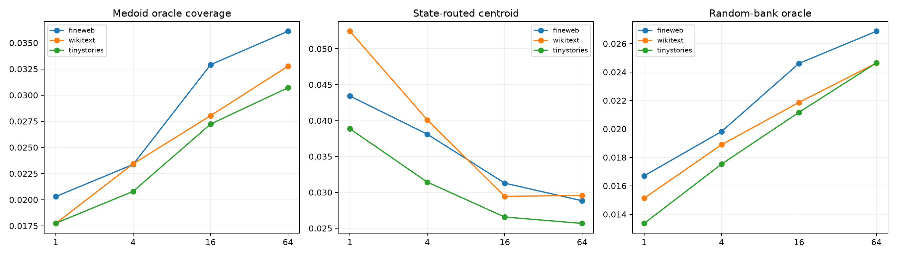

# High-resolution red team of Layer-8 conditional quantization

The discovery set is expanded to 256 exact local Fisher subspaces and the bank to 64 prototypes. Grassmann centroids are compared with actual discovery medoids, matched random subspaces, state-centroid routing, oracle prototype selection, and a nearest-native-context router.

## Locked hypotheses

- **R1_sixtyfour_medoids_cover_local_axes: not supported.**
- **R2_learned_prototypes_beat_random: not supported.**
- **R3_state_router_recovers_useful_capture: not supported.**
- **R4_nearest_context_predicts_local_subspace: not supported.**
- **R5_more_prototypes_improve_coverage: not supported.**
- **R6_negative_or_positive_regime_transfers: supported.**

| Corpus | K | Centroid oracle/routed | Medoid oracle/routed | Random oracle | Route match C/M |
|---|---:|---:|---:|---:|---:|
| fineweb | 1 | 0.043/0.043 | 0.020/0.020 | 0.017 | 1.000/1.000 |
| fineweb | 4 | 0.046/0.038 | 0.023/0.021 | 0.020 | 0.292/0.396 |
| fineweb | 16 | 0.044/0.031 | 0.033/0.021 | 0.025 | 0.250/0.188 |
| fineweb | 64 | 0.043/0.029 | 0.036/0.023 | 0.027 | 0.250/0.208 |
| fineweb | nearest context | — | — | — | capture 0.032 |
| wikitext | 1 | 0.052/0.052 | 0.018/0.018 | 0.015 | 1.000/1.000 |
| wikitext | 4 | 0.046/0.040 | 0.023/0.018 | 0.019 | 0.312/0.292 |
| wikitext | 16 | 0.040/0.029 | 0.028/0.017 | 0.022 | 0.083/0.083 |
| wikitext | 64 | 0.039/0.030 | 0.033/0.022 | 0.025 | 0.167/0.125 |
| wikitext | nearest context | — | — | — | capture 0.022 |
| tinystories | 1 | 0.039/0.039 | 0.018/0.018 | 0.013 | 1.000/1.000 |
| tinystories | 4 | 0.038/0.031 | 0.021/0.018 | 0.018 | 0.354/0.312 |
| tinystories | 16 | 0.036/0.027 | 0.027/0.019 | 0.021 | 0.208/0.188 |
| tinystories | 64 | 0.036/0.026 | 0.031/0.022 | 0.025 | 0.146/0.146 |
| tinystories | nearest context | — | — | — | capture 0.023 |

Training-set Grassmann similarity verifies that clustering itself fits its declared objective. Held-out failure would therefore identify nonrecurrent downstream-conditioned axes rather than an implementation failure.
